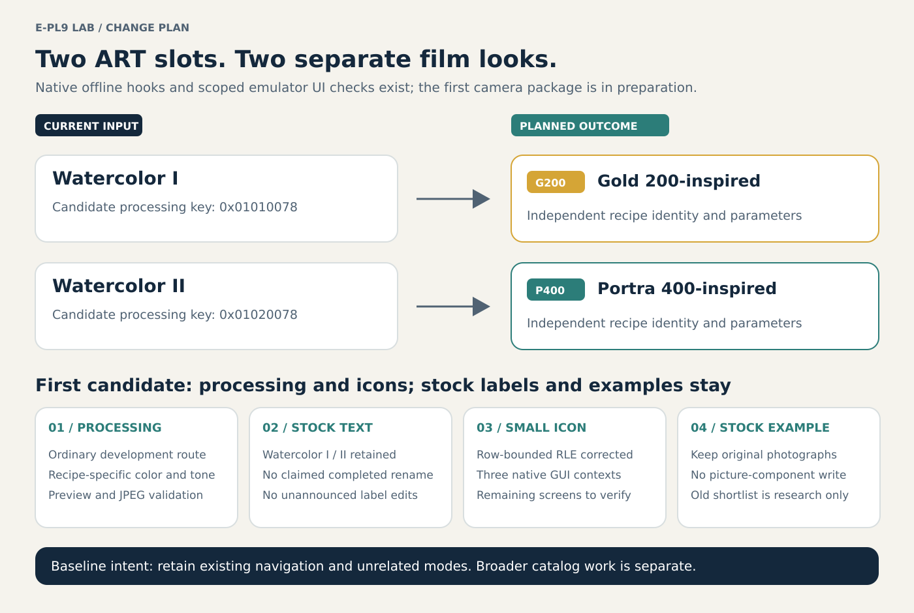

# E-PL9 Lab

[First-integration readiness](docs/first-integration-readiness.md) · [Current status](docs/project-status.md) · [Documentation directory](docs/README.md) · [Risks and limitations](docs/risks-and-limitations.md) · [Continue or port the research](docs/porting-guide.md)

> **Experimental amateur research — use entirely at your own risk.** The owner is learning as they go, has no specialist camera-firmware expertise, and uses AI assistance. Code, analysis and documentation may be wrong, incomplete or misleading, even when tests pass. This is not an official Olympus/OM System project or a supported firmware product. There is no installable firmware modification, validated recovery procedure or guarantee of compatibility. Experimental camera changes can cause permanent damage, an unusable camera or lost files. See the [full limitations](docs/risks-and-limitations.md).

This public repository is intended to let anyone inspect, question, reproduce and continue the investigation, including for other cameras. The reusable starting point is the research method and evidence, not transferable E-PL9 patch addresses.

Tools and research notes for an Olympus PEN E-PL9 camera.

## Research goals

1. Investigate applying named film recipes, then replacing ART presets with in-camera film looks.
2. Document the camera's Wi-Fi API and USB interfaces.
3. Build an offline-capable browser interface for browsing and downloading original files, and measure transfer performance.
4. Investigate synchronized gyro logging for Gyroflow and full-field 1920×1440 video at 60 fps; these remain requested targets, not working modes.
5. Determine hardware and firmware limits before making claims about additional video modes, including 4K60.

These are research goals. A working E-PL9 firmware modification has not been produced by this project.

The first implementation baseline is [Watercolor I → Kodak Gold 200-inspired and Watercolor II → Kodak Portra 400-inspired](docs/watercolor-gold200.md), preserving unrelated modes. The broader library and possible later built-in/SD split are a separate design backlog; neither a 29-recipe workstream nor the earlier 31-profile catalog establishes implemented camera slots.

**On hold:** Log, 10-bit and HEVC research, by owner decision on 2026-11-04. No practical quality/dynamic-range gain or genuine ten-bit recording is established. Preserve the [findings and resumption limits](docs/log-ten-bit-handoff.md); do not automatically restart this direction. Other project goals remain separate.

## Current evidence, 2026-11-07

**A native offline integration and partial native-menu icon integration now exist. The first camera-test package is being prepared; it is not yet a camera-tested or demonstrably safe release.** See [first-integration readiness](docs/first-integration-readiness.md) for what is done, active and still blocking a trial.

| Area | Current result | Remaining limit |
| --- | --- | --- |
| Native processing | [Late native hooks](docs/epl9-late-film-integration.md), [stock producer/owner binding](docs/epl9-native-owner-binding.md) and [early-load checks](docs/epl9-native-owner-load-validation.md) execute in bounded offline state; a missed exact `0x1000` ART kind was fixed | Actual ISP pixels/completion, all caller/concurrency/lifetime and physical code-slot behavior |
| Native UI | [OM-Emu](docs/epl9-omemu-ui-validation.md) displays corrected G200/P400 icons in three screen contexts, with controlled stock comparisons | Two bitmap pairs and ART/example-screen modeling remain open; the UI route never executes the five processing hooks |
| Recipe direction | Public [v2 desktop trials](docs/epl9-tonal-neutral-trials.md); current v3 multi-scene review and package binding are reported by the active work | Frozen v3 inputs still need an identified release manifest; no calibrated camera result |
| First package | Integration chat is assembling install and stock-return containers for main and OSD/icons, with recipes kept fixed | Full-size exact-package validation and physical entry/recovery/runtime qualification remain open |

For the first candidate, **keep the existing large ART example photographs unchanged**. The current tested text labels are still Watercolor I/II. SD-loaded recipes, the wider library and video/Wi-Fi changes are separate follow-ups; none is silently included in this package.

The latest published public numerical definitions here remain [v2](recipes/epl9-film-drafts-v2.json), retaining [v0](recipes/epl9-film-drafts-v0.json) and the negative [v1 gamma experiment](recipes/epl9-film-drafts-v1.json). They must not be confused with final frozen v3 package inputs or diagnostic native matrix/RGB values. [Current status](docs/project-status.md) identifies source availability and active work. Firmware and private images remain ignored.

## Planned changes and future installation

The [illustrated change plan](docs/planned-changes.md) shows the two-slot processing, name, icon and menu-example changes, with conceptual selection cards and a status map for parallel investigations. The [readiness review](docs/first-integration-readiness.md) distinguishes those concepts from the recorded native GUI checks and the pending first package. The [future installation and recovery guide](docs/firmware-installation-plan.md) explains the official stock USB route, candidate custom SD route, preparation and unresolved restore limits. It is a planning document, not an instruction to flash now.



Follow [CHANGELOG.md](CHANGELOG.md) for meaningful updates, validation and limitations.

## Local workspace

The initial Windows checkout is `D:\EPL9Lab`. Public source and documentation are separated from ignored local data:

| Folder | Contents | Published |
| --- | --- | --- |
| `scripts/` | Diagnostics and offline inspection tools | Yes |
| `docs/` | Scope, sources and verified findings | Yes |
| `recipes/` | Versioned original draft parameters, not installed firmware | Yes |
| `firmware_src/` | Original assembly templates for offline native integration | Yes |
| `assets/` | Original artwork, diagrams and source metadata | Yes |
| `tools/`, `downloads/` | Installed tools and their installers | No |
| `references/` | Independent upstream Git checkouts | No |
| `local/` | Machine configuration, installation records and private reports | No |
| `firmware/`, `captures/`, `samples/` | Firmware files, packet captures and camera media | No |

## Start

Run the workstation check from PowerShell:

```powershell
.\scripts\doctor.ps1
```

For an offline file identity report, use Python 3.12 or newer:

```powershell
.\.venv\Scripts\python.exe .\scripts\firmware_info.py .\firmware\camera-update.BIN --output .\local\firmware-info.json
```

The inspector reads a local file and reports its size, SHA-256 and initial bytes. It does not decode, modify or flash firmware.

Start with the [documentation directory](docs/README.md) and [clean-checkout prerequisites](docs/windows-setup.md#clean-checkout-and-cloud-reproduction-2026-11-04). The original first-session checklist is historical: owner media, desktop exports and initial USB observations now exist. Live camera behavior remains limited to specifically recorded observations; USB enumeration is not full firmware-dump or update readiness. The [offline browser-client note](docs/offline-browser-client.md) separates a cached interface from camera-network access.

## Continue the project

Start with the [handoff and porting guide](docs/porting-guide.md) for the reading order, current blockers and a new-model checklist. [CONTRIBUTING.md](CONTRIBUTING.md) defines how to report evidence, corrections and reproduction steps. An unsupported instruction or missing dependency is an unresolved result, not a successful camera feature.

## License and reuse

Original project material is available under the [MIT License](LICENSE), except the MN103 reader's C/header files, which retain **GPL-3.0-or-later**. See [licensing and third-party notices](docs/licensing.md) and the [GPL text](LICENSES/GPL-3.0-or-later.txt). Firmware, manufacturer assets and independent upstream projects are not relicensed by this repository. Forks and ports are welcome; preserve applicable notices and describe what was actually verified.
