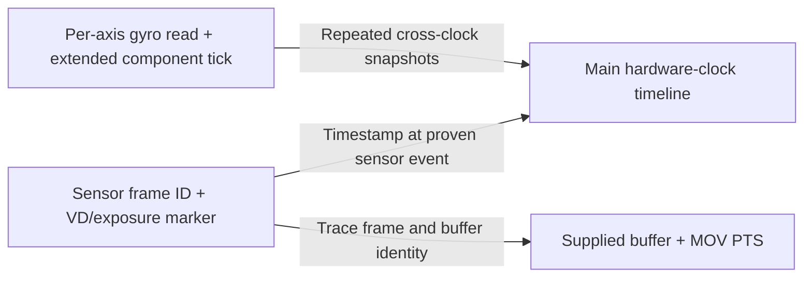

# E-PL9: sensor frame timing and gyro/video clock association

## Result of the next offline pass

The accepted target remains **1920×1440, full usable 4:3 field, 60 fps**, with
gyro data saved during recording. This pass identifies configured sensor-period
fields, actual clock-reading instructions in both components, and the video
PTS-generation path. **It does not establish a full-field 4:3 sensor schedule
at 60 fps, an absolute gyro sampling frequency, or exposure-aligned timestamps.**
No hardware timing measurements, camera commands, firmware changes or flashing
were performed. In particular, a configured/requested period is not a measured
sensor period, and a video-buffer delivery timestamp is not an exposure timestamp.

The [2026-11-04 follow-up](#2026-11-04-actual-tg-registers-and-separate-exposurecapture-identities)
below adds actual TG register writes, a registered callback with separate
exposure/capture numbers, and the software origin of the PTS input ordinal.
The full recording-settings-to-TG and exposure-to-MOV joins are still open.
The [second November 4 pass](#second-november-4-pass-tg-template-producers-and-hardware-irq-marker)
then identifies the TG payload producers, a rate-ignoring FULL-mode fallback,
a hardware TG IRQ marker and the PTS-bearing supply descriptor.
The [third November 4 pass](#third-november-4-pass-camera-clocks-and-the-exposure-timestamp-join)
resolves the marker's notification record into the exposure descriptor and
separates a calculated 36 MHz camera output clock from the unresolved TG clock.
The [fourth pass](#fourth-november-4-pass-marker-offset-provenance-and-stabilizer-center-request)
traces the offset producer, the firmware's 144-tick time-conversion model,
and a conditional image-work/stabilizer association. The [fifth pass](#fifth-november-4-pass-correcting-the-60-fps-gate-and-checking-an-original-mov)
corrects the earlier gate interpretation: normalized rates <=60 reset the
accumulator and **return 1 (accept)**. It also identifies a calculated 144 MHz
CLKCAMDS branch and verifies cadence, composition offsets and edit-list timing
in an already downloaded original MOV. TG's physical clock source and the
exposure-to-encoded-sample join remain unresolved.
The [sixth pass](#sixth-november-4-pass-processing-records-pixel-source-descriptors-and-native-mov-timing)
extends capture identity into a processing ring, identifies the source pixel
address field and its software queue, and reaches native MOV timescale/CTTS
construction. It preserves the unresolved instance/generation joins and TG
clock-parent boundary.
The [seventh pass](#seventh-november-4-pass-slot-generations-encoder-metadata-and-mov-sample-boundaries)
finds a per-slot build generation, corrects the interpretation of copied
descriptor words, and follows timestamp metadata locally through source,
encoder and mux code. These are conditional object-level fragments: the
connection instances and exposure-to-pixel-generation association remain open.
The [eighth pass](#eighth-november-4-pass-q-completion-message-provenance)
traces Q through two different message layouts: completion command 36 becomes
processing event 37, and selected states forward the same pointer through
command 25 to source event 9. This identifies upstream senders, not Q's original
allocation or its association with an E generation. A retained-buffer branch
can replace Q's source address. TG initialization adds control-register writes
but no verified CLKCAMDS-to-counter wiring.
The [ninth pass](#ninth-november-4-pass-q-constructor-and-the-real-request12-writer)
finds Q's separate 16-slot heap pool, snapshot constructor, pixel-address
producer and the command-7 writer of request +12. The command-1 render payload
must be kept separate from Q. A native diagnostic names an auxiliary TG
counter `free`, but its clock parent/units and the E-generation/MOV join remain
unverified.
The [tenth pass](#tenth-november-4-pass-q-mode-gate-alternative-source-and-tg-free-callbacks)
finds that the known public configuration classifier cannot produce Q's mode 2,
and traces a separate pixel-argument source route. Its exposure/MOV identity
remains open. Default TG `free` comparison callbacks receive zero rather than
a counter snapshot; this still supplies no hardware clock-parent proof.
The [eleventh pass](#eleventh-november-4-pass-alternative-source-states-and-the-queued-pts-join)
closes the alternative source's queue-to-PTS-builder fragment and distinguishes
it from direct supply. It identifies conditional source states, a cyclic pixel
slot key and capture-number storage in an intermediate job. Ordinary-60 state
selection, pixel generation/exposure identity and final MOV sample identity
remain open. TG `free` delays have native VD/phase-counter inputs, but still
no proven physical clock parent.

This pass started on dirty branch `main`, HEAD
`0ffe98ad7807c268fe2bf29e5a6251a063773835`; other chats' work was preserved.
Inputs are the same Olympus PEN E-PL9, catalog model `1330`, owner-displayed
version `1.1`, stock internal main build `1101`:

| Input | Bytes | SHA-256 | Analysis base |
| --- | ---: | --- | --- |
| `OLY_E_133_1101_0000_0000.BIN` | 104552480 | `aefab05396c43ecba0551b94a5d31f7e52350c18d6f4bf1d02d75761108e6028` | Container |
| `00_0100_406e0020.decoded.bin` | 26214336 | `8e39c335d54fd8ddea189db82fe708159f43f9995bba42c2cd47dd22b8814267` | `0x60400020` |
| `03_010e_40002820.decoded.bin` | 219104 | `1c942d2fb6b8830f0195a0be7464880838ddf08c5f038bad626aed8e72789678` | `0x40002800` |

The displayed version does not identify bytes installed on the owner's body.
Other decoded package components were inventoried locally as resource leads;
none supplies a validated sensor timing schedule in this result. Their sizes
and hashes are retained in ignored `local/video-clock-20261102/clock-leads.json`.

## Configured sensor periods: concrete fields, still no full-field schedule

The diagnostic help names `cam_1vd_cycle_hd` and `cam_1vd_cycle_time`.
Native descriptor construction at `0x605eea39` makes the association more
specific. Relative to the 56-byte descriptor at **`0x625a58e8`**:

| Descriptor field | RAM address | Evidence |
| --- | --- | --- |
| `+30`, unsigned 16-bit | `0x625a5906` | Input `+0` copied here at `0x605eea3d`; diagnostic at `0x605ef633` prints `vd_hd`. |
| `+32`, 32-bit | `0x625a5908` | Input `+4` copied here at `0x605eea43`; diagnostic at `0x605ef646` prints `vd_time`. |
| `+36/+40`, 32-bit | `0x625a590c/0x625a5910` | Input `+8/+12` copied here; their exact acquisition/exposure semantics remain open. |
| `+44`, byte | `0x625a5914` | Input `+18` copied here; used as a mode in downstream period logic. |

`0x604f916f` is a higher-level configuration adapter. It constructs this input
from a caller object: object `+52` supplies the HD count, `+48` the period,
and `+36/+40` the following two values. It then calls `0x605eb11a`, which feeds
the descriptor builder. This is a trace of **requested configuration**, not
proof that the hardware accepted that period for a particular active rectangle.

Do not conflate these with two other state cells:

- **`0x625a5a10`** prints as `VDcycle`.
- **`0x625a5a14`** prints as `LSEXPcycle`, not `cam_1vd_cycle_time`.

The period-changing paths update these effective/long-exposure values and pass
them through `0x605edd3d → 0x605d737b` or `0x605edd62 → 0x605d7294` into
software scheduling. `0x605eebc3` classifies intervals into nominal rates:
thresholds include 6000, 12000, 18333, 26666, 36666 and 40833; the corresponding
branches yield 240, 120, 60, 50, 30, 25 or 24. These values support a
microsecond interpretation in that logic, but the classification buckets are
not measured frame periods or hardware limits.

**What still prevents a yes/no answer about full-field 60:** we have not joined
one normal recording preset to all of (a) these requested periods, (b) the
correct 4:3 active sensor rectangle, (c) sensor/TG register writes, and (d) the
clock/divisor/blanking values determining actual readout. The 35 geometry rows
from the [previous investigation](epl9-opengate-video.md) contain none of those
missing clock measurements by themselves.

For true 60 fps, the frame budget is **16666.6667 µs**. The relevant test is
`T_frame = HD_total × T_HD`, including blanking and sensor-specific sequencing,
with the same usable 4:3 field as the still-image baseline. Active image height
is not a replacement for `HD_total`. A 1536×1152 geometry does not automatically
mean 1152 sensor timing lines or prove threefold faster readout.

### Rejected leads retained for continuity

`0x605d8c7a` populates 36-byte runtime records at device-object `+8244` from
column-wise incoming data. Another path selects a 19-entry ROM index at
`0x605744f0`, copying 32-byte source records into the same layout. Initial
inspection made this look like a possible sensor timing table. Its values have
floating-point coefficient-shaped bit patterns, and no line-clock consumer was
established. It is **not an identified timing schedule**. Its optical/calibration
interpretation also remains a hypothesis.

The model-data receive dispatch at `0x605e3a07/0x605e3a1e` and callback setup
at `0x605e341c` show that some device data is populated through transactions.
They do not prove that the missing sensor timings live outside the stock image.
We must not declare a camera dump necessary on the basis of this lead alone.

Similarly, main address `0x604a0924` is an occurrence inside a register metadata
table, not a clock initialization function. Disassembling that data as native
instructions was rejected. These exploratory windows stay local and are not
instruction anchors used to establish executable initialization code.

## Main hardware clock: a usable candidate, not yet an exposure clock

The native time service is now explicit:

```text
0x60401e69 → 0x60401e71
read 32-bit MMIO 0x9890014c
return 0x3fffffff - register_value
```

Timer register metadata at `0x604a0700 + 27×20` is
`(0x9890006c, 0x989000dc, 0x9890014c, 0, 0)`, associating the read with timer
27 in that framework. The wrap helper `0x604516cf → 0x60451954` returns
**`0x3fffffff`**. Existing callers use that constant to repair a wrapped
subtraction. Preserve the raw counter and its wrap epoch; confirm reload/end
semantics before assuming an inclusive `2^30` hardware period. The absolute tick
frequency has not been independently established in this pass.

This clock is read by period-scheduling code and by video-buffer supply code.
It offers a common main-component timeline. **No native connection between
this counter and a proven first-row exposure event has been found yet.**
For example `0x605d5fd3` timestamps a camera request and stores time in request
`+16`; calling that an exposure interrupt would be unjustified.

## Stabilizer clock: existing phase counter and relative timer periods

The CPU1-labelled component has an existing short-interval counter reader:

- **`0x4000b797`** reads 16-bit **MMIO `0x9c050010`**, saving it in a
  profiling object. Stop/difference code reads the same counter.
- Its delta helper **`0x4000b7f5`** repairs one wrap using **50000**. This is
  a phase counter; reading it alone cannot produce a long monotonic timestamp.
- **`0x4001753b`** allocates timer 0, configures comparator value **50000**,
  callback `0x40017578`, and starts it. The register table maps comparator A
  to `0x9c050008` and the counter to `0x9c050010`.
- The roll-gyro timer setup from the previous pass allocates timer 2 with
  comparator **12500**. Both configurations use zero in the visible
  clock-selection/control fields and pass through `0x40009884`.

With a shared effective timer input and those comparator semantics, the roll
callback's nominal period is one quarter of timer 0's period. This is a useful
**relative** relation. It is not proof of a 1 ms system timer, a 250 µs roll
sample period, a 4 kHz sensor output rate, or new data on every poll. Those
absolute values still need clock-tree and gyro-conversion evidence.

The logger candidate is an overflow-extended timer-0 counter, or another proven
monotonic counter discovered later, captured at the [actual per-axis read
points](epl9-gyro-logging.md#where-the-values-originate). Extending the phase
requires an overflow epoch and an atomic/race-safe snapshot. A low-frequency
poller cannot infer how many unobserved 50000-count wraps occurred. Installing
an extra timer callback is not validated or authorized for the camera phase.

## Video PTS are not raw capture timestamps

A concrete video supply path starts at **`0x607b9f2f`**. It reads the rate
field from per-stream object `+104`, keeps a per-stream PTS accumulator at
**`0x62a05b30 + stream×4`**, and resets that accumulator on a zero input
ordinal/counter at input `+8`. Input `+12` controls the number of supplied
items. The ordinal's relation to sensor-frame identity is still unproven.

The cadence dispatch is a 16-slot hash table at **`0x60906acc`**, with key
`rate - 2396`. Exact rate key **5994** selects `0x607ba01c`, alternating
increments **1501/1502** according to ordinal parity. Other supported branches
use **9000000 / rate**. This is consistent with a 90 kHz PTS scale and rates
expressed in hundredths, rather than exposure-time sampling. Under that scale,
the 1501.5 average increment corresponds to **60000/1001 ≈ 59.94006 fps**.
This identifies software cadence, not the physical sensor frame rate or the
rate of an original MOV from this body.

It matters for the owner's “60 fps” target: exact 60 and 60000/1001 have
different timelines. Never synthesize gyro times as `frame_number / 60` if the
actual stream uses fractional cadence. The target has not been silently changed
to fractional cadence; both actual sensor and actual MOV timing must be checked.

At **`0x607ba2d6..0x607ba31e`**, the `[Vid] ID / PTS / Addr / Switch /
timecode / time` diagnostic combines the saved PTS with a fresh call to
**`0x60401e69` at `0x607ba308`**. It then supplies the buffer through an
indirect callback at `0x607ba34a`. Thus this path is a concrete place to observe
**`stream, supplied-buffer address, ordinal, PTS, main delivery-clock tick`**.
The PTS is saved before the cadence accumulator is advanced.

That provides a useful buffer/PTS association, but its hardware-clock reading
is taken during **delivery**, after upstream work. Queueing, ISP and buffering
delay have not been bounded. Pairing it with gyro samples as if it were exposure
time would encode that unknown delay into stabilization. The existing debug
formatting path should not become a real-time file logger.

## Concrete synchronization design and remaining native trace

There are **three separate associations** to establish:



1. **Map component ticks to main ticks.** A proposed batched telemetry extension
   can include a clock exchange: main sends at `M1`, component receives at `G2`,
   component replies at `G3`, main receives at `M4`. For a positive affine map
   `M = aG + b`, nonnegative path latency gives
   **`M1 - aG2 ≤ b ≤ M4 - aG3`**. Repeat exchanges throughout the take to
   constrain clock ratio/drift and uncertainty. A midpoint is an estimate, not
   exact synchronization; asymmetric queue delay must not be concealed. No
   such exchange has been implemented or observed in the stock protocol here.
2. **Attach main time to a real sensor event.** Trace the TG/VD interrupt and
   frame number to a marker with established meaning: readout start, end, or
   exposure start. Record exposure duration and mode-dependent phase. VD is
   not automatically the first-row exposure start. Rolling-shutter timing
   needs a valid line count and line period; it cannot be derived from PTS.
3. **Join sensor identity to recorded frames.** Trace capture → ISP/YUV buffer
   → video supply → encoded packet/MOV. Retain dropped/repeated-frame and split
   information. The supply code above provides one downstream join point; a
   buffer address alone can be reused and needs a generation/sequence identity.

Raw sidecar records should preserve per-axis sequence, raw tick, wrap epoch,
raw count and validity; separate frame/sync records should preserve these
associations and uncertainty. Convert to GCSV only after units, orientation and
the clock/exposure mappings are established. A fixed REC-button offset cannot
replace these three associations.

Next native work is now specific: find the producer of the normal movie
configuration passed into `0x604f916f`, tie its period/HD count to sensor/TG
register programming for a full 4:3 rectangle, and trace the upstream frame
identity feeding `0x607b9f2f`. Independently establish the timer-0/timer-2 input
clock and overflow source. These are unresolved analysis tasks, not claims that
a patch would work once a few constants are changed.

## Reproduction and verification

New `scripts/epl9_video_timing_audit.py` rechecks the stock/main/component
identities, timer register metadata, the 5994 cadence dispatch, five exact
diagnostic strings, and **51 instruction anchors across 19 windows**. Evidence:
ignored `local/video-timing-audit-20261102-v1/audit.json` and TSV listings.
The existing seven synthetic audit safety tests pass; the native audit passed
on the exact images. These are static checks, not a sensor/clock emulator.

```powershell
.\.venv\Scripts\python.exe -m unittest discover -s scripts -p 'test_epl9_video*_audit.py' -v
.\.venv\Scripts\python.exe scripts/epl9_video_timing_audit.py --out local/new-video-timing-audit
```

Raw exploratory disassemblies, including rejected data-as-code leads, remain
under ignored `local/video-clock-20261102/`. No installation/recovery mechanism
or safe hardware execution has been established by this audit.

## 2026-11-04: actual TG registers and separate exposure/capture identities

The next offline pass reached **real TG MMIO writes** and a registered camera
callback carrying **separate exposure and capture frame numbers**. It has not
joined the configured recording mode to a particular full-field TG block, or
the exposure number to a supplied video buffer/MOV PTS. **1920x1440 full-field
4:3 at 60 fps remains unverified.** These findings extend the earlier trace;
they do not close its missing links.

All addresses below use the exact E-PL9 model 1330 stock input, displayed
version 1.1 / main build 1101, identified above. Main image size is 26214336
bytes, SHA-256
`8e39c335d54fd8ddea189db82fe708159f43f9995bba42c2cd47dd22b8814267`,
base `0x60400020`. Stock update size is 104552480 bytes, SHA-256
`aefab05396c43ecba0551b94a5d31f7e52350c18d6f4bf1d02d75761108e6028`.
No camera was accessed.
This follow-up started on dirty `main`, HEAD
`e973bed1beb1a6d03f1b83cc1096f7ed15d18b07`; unrelated work was preserved.

### TG hardware endpoint: identified, with mode producer still missing

The diagnostic query at **`0x61752f10`** calls native getters whose output is
printed as `TG VD CYCLE[HD]` and `TG HD CYCLE[CLK]`. This is stronger evidence
than the earlier software `vd_hd`/`vd_time` labels:

| Native getter | Actual register/field | Meaning supported by diagnostic |
| --- | --- | --- |
| `0x60538337` | `0x9b00008c & 0x7fff` | TG VD period in HD units |
| `0x6053836c` | `0x9b000094 & 0x7fff` | TG HD period in clock units |
| `0x60538350` | `(0x9b00008c >> 16) & 0x7fff` | Separate field; not a proven frame counter |

The getters first read `0x9b80060c` and save that value to `0x626076d8`.
Its synchronization/bridge role is not fully established. The values are not
being read from a live camera by this investigation.

**`0x60537255` is the writer.** With `C` its command context:

```text
collection = *(C + 36)
T = *(collection + 8)
for i = 0..12:
    MMIO32[0x9b00008c + 4*i] = uint32(T + 4*i)
return uint32(T + 52)
```

Thus `T+0` and `T+8` feed the two hardware period fields, and the complete
52-byte register payload covers `0x9b00008c..0x9b0000bc`. The extra word `T+52`
is a software return/completion value, not a fourteenth MMIO write. The writer
does not mask or calculate the period; that must happen upstream.

The actual staging/apply path is:

```text
0x6053678b: command 7 -> 0x60536e3d (stage collections)
                         -> 0x60536ede
              pending mask: 0x6260774c
              first pending-context array: 0x626076f8
0x6053678b: command 9 -> 0x60536f66 (apply selected pending collection)
                         -> function pair table 0x605a6160, stride 8
                         -> entry 1 writer 0x60537255
                                    completion 0x605370aa
```

Commands are decoded by the 32-slot hash table at `0x605a64d4`, key
`command-2`; they are not sensor-mode numbers. There are two eight-entry pending
arrays selected by the apply command's byte `+20`, plus a separate five-entry
collection. Preserve this selection and completion behavior in further tracing.

This locates the **hardware end** of the configuration chain. The earlier
`0x604f916f -> 0x605eb11a -> 0x605eea39` trace locates its **recording-settings
end**. The producer that fills `T` for that particular movie configuration has
not been established. The adapter `0x6050eee4` submits a nested SYNC command at
input `+8`, alongside other device commands; its existence alone does not bridge
the two ends. Do not equate descriptor `vd_hd` with `T+0` merely because both
have HD-related labels.

The actual TG clock input, prescaler/PLL selection, count encoding (`N` versus
`N-1`), active-window/readout schedule and binning/skipping mode are still
unresolved. Consequently there is no defensible numerical line time, full-field
readout time, or 60 fps register patch yet. A product of two register fields
would only become a frame-period calculation after those semantics are known;
it would still not prove the full usable sensor field was read.

### Camera callback with exposure and capture frame numbers

The previous search for an upstream identity now has a concrete native path:

1. **`0x6091ee56`** initializes an owner request. At `0x6091eef7..0x6091ef06`
   it installs callback **`0x6091efec`** at owner `+68+32`, with mask
   **`0x00010193`** at `+68+76`. It registers through `0x605ca0e7`.
2. `0x604feecf` installs the forwarding wrapper **`0x604ff43e`** into the
   lower camera request. That wrapper tests the owner's mask and forwards the
   enabled event bits to the callback at `+68+32`.
3. **`0x6091efec`** distinguishes event values `1`, `2`, `16`, `128`, `256`
   and **`0x10000`**. It reaches the descriptor at
   `D = *(request+40)+340`.
4. The event-1 branch calls **`0x6091f0ba`**, which reads **`D+48`** and updates
   **`0x62618540`** through `0x60920217`.
5. The event-`0x10000` branch reaches **`0x6091f65e`**. Its accepted cases
   update **`0x6261853c`** from **`D+44`**, through `0x60920242`.

The diagnostic at `0x60680f89..0x60680faf` independently labels these globals
`lsat_frame_number_capture` and `lsat_frame_number_expose` (the spelling `lsat`
is in the firmware). They are distinct identities, not merely different names
for the video supply ordinal.

There is an important conditional in the exposure commit: for a selected record
whose field `+12` is zero, it accepts `0x10000`; for field `+12` equal to one,
it accepts event `1`. That field's mode/phase semantics remain unresolved. The
capture branch can also call the exposure commit. Therefore do not rename
`0x10000` to “first-row exposure-start IRQ” or assume every callback produces a
new recorded movie frame. Duplicates, mode transitions and dropped frames must
remain observable.

This gives a proposed instrumentation point with a reviewable record shape:

```text
owner/request identity + generation
raw event mask + main clock sampled at callback entry
descriptor D + D[44] exposure sequence + D[48] capture sequence
selected record mode/phase flags + configured exposure/VD fields
```

It is a **software camera-event point with frame identity**, not yet a proven
hardware exposure-time point. The lower event producer still needs to be traced
through `0x605338b6` / scheduled actions `0x605343dc` into their native handlers.
`0x6053506e`, `0x60534c3c` and the SYNC callbacks are the next specific leads.
Verify movie-mode reachability and physical phase before treating this event as
the timing reference for gyro stabilization.

Calls to the main hardware counter at **`0x6091f228`** and **`0x6091f269`** save
time to an associated request's `+416`. Both occur inside the software capture
handling path, with conditional updates. They do not establish an exposure
timestamp, and must not be substituted for the missing sensor-event timestamp.
The fourth pass establishes the alias **`body+416 == D+76`**, since
`D = body+340`. Thus these branches can overwrite the same field later used
for the scheduled TG-associated timestamp. They are alternative provenance
paths, not a separate timestamp field.

### The PTS input counter is generated by the supply queue

The producer of the earlier `0x607b9f2f` input ordinal has now been traced:

```text
0x60718d79 -> 0x607b99d4 -> 0x607c2ab4
                                  -> 0x607b98ba (queue)
                                  -> 0x607c2f69 (worker, message 0x1005)
                                  -> 0x607b9f2f (cadence/PTS accumulator)
```

At `0x607c2ac9` the producer reads software counter **`0xa2afb57c`**, and at
`0x607c2b15..0x607c2b1c` it increments it. For configured group size `g`, it
stores **`floor(counter/g)*g` at payload `+8`** for a nonnegative counter and
positive `g`, with the supplied group count
as a **byte at `+12`**. It collects buffer references in a ring and sends the
group message. This is the direct source of the ordinal used for cadence/PTS.
It does not copy `0x6261853c` into that ordinal.

That disproves treating the PTS input ordinal as an already-proven sensor
frame counter. The native division/multiplication is signed; wrap behavior also
needs preserving rather than extrapolating this expression indefinitely.
It does not prove that their rates differ: they may coincide
while streaming normally, but the identity mapping has to be carried through
the buffers and checked across queue loss, repeats, resets and grouped delivery.

The required remaining join is now explicit:

```text
sensor event + exposure sequence
  -> capture sequence / capture-buffer generation
  -> video-buffer item in 0x607c2ab4
  -> grouped supply ordinal
  -> saved PTS at 0x607b9f2f
  -> actual encoded packet / MOV sample PTS
```

### Other leads and rejected shortcuts

- `NOTIFY_EXPOSE_CENTER`, its panorama variant, and `ANG_VEL_EXPOSE_YAW`,
  `PITCH`, `ROLL` exist in the body-controller protocol/debug material. Native
  debug handling refers to capture/panorama/clip fields. Their names alone do
  not show a raw per-sample movie gyro stream or an exposure event from the
  sensor. Direction, payload semantics and movie cadence remain to be traced.
- Descriptor `0x625a590c` is printed as **`exp_vd_hd`**, and `0x625a5910` as
  **`center`**. A configuration help string describes
  `cam_vd_eddge_to_center_hd`. This supports investigating an HD-based VD-to-center
  phase parameter, without establishing its sign, physical phase, runtime mode
  or equality to a hardware exposure marker.
- The 33-entry table at `0x605a638c` and associated counters are **LVDS error
  handling** (`8B10BERRMON`, payload/header/footer errors, phase-lock/comma/skew
  errors). They are not exposure frame counters.
- Raw literal occurrences at `0x605925a8` / `0x60592cf8` belong to register
  metadata; decoding that data as instructions does not discover another
  register writer. Exploratory windows starting in the middle of an instruction
  were also excluded from the audited chains.

### Reproduce this pass

New **`scripts/epl9_video_register_audit.py`** verifies the exact stock/main
identity, TG command hash branches, writer/completion table entry, diagnostic
labels and **96 instruction anchors across 18 windows**. It records unresolved
clock/count encoding, full-field 60 fps, exposure phase and MOV join as false
verification flags. The native audit passed; all seven existing synthetic
video-audit guard tests passed. These checks verify static evidence and audit
guards, not hardware behavior or a working recording modification.

```powershell
.\.venv\Scripts\python.exe scripts/epl9_video_register_audit.py --out local/new-video-register-audit
.\.venv\Scripts\python.exe -m unittest discover -s scripts -p 'test_epl9_video*_audit.py' -v
```

Evidence is ignored `local/video-register-audit-20261104-v2/audit.json` and its
TSV listings. Wider exploratory windows remain in ignored
`local/video-registers-20261104/`. No firmware patch or camera write was made.

## Second November 4 pass: TG template producers and hardware IRQ marker

This pass started on dirty `main`, HEAD
`9487c76528dc21f6834d94d379fd0528b57ff153`, preserving unrelated work. It uses
the same exact E-PL9 model 1330, owner-displayed version 1.1 / main build 1101
stock and decoded main sizes/hashes above. All work remained offline.

**The producer of the TG payload is now identified.** The native `FULL` path
selects an existing generic template, not an explicit full-field 60 fps entry.
A separate hardware TG interrupt can also be traced to a clock-reading
callback. Neither result yet establishes 1920x1440 full-field/60, the physical
exposure phase, or the exposure-number-to-MOV-sample join.

### Exact TG payload ownership and filling

With `A` the sensor action's parameter-pointer record, **`A+72` points to the
56-byte TG timing block**. Native allocation at `0x6053523c..0x60535240` sets
that pointer to payload-pool base `+384`. Pool slots advance by 8312 bytes.
The collection constructor at **`0x605358b1..0x60535912`** binds `A+72` to
collection `+8`, exactly the pointer consumed by the previously verified TG
writer `0x60537255`. This closes the pointer-alias gap between a parameter
producer and the MMIO writer.

There are several producers of this same block, according to the action:

| Producer | Source | Action |
| --- | --- | --- |
| `0x6051f7c1` | `0x6059a51c` | Copies 14 words of a common template. |
| **`0x6052053c`** | **29-pointer table `0x605a2b20`** | Selects a template using the mode index and copies 14 words to `A+72`. |
| **`0x60521915`** | **29-pointer table `0x605a38b8`** | Alternate action/template family, same 14-word destination. |
| `0x605228d6` | `0x60947954` | Another fixed-template action. |

The two indexed producers obtain the selector from an action input's `+52`,
through **`0x6051ccad`**. For values `0..28`, its jump table at `0x605a47bc`
returns the same index. Other values must not be indexed into these 29 rows.
The producers set the timing-block pending bit `2` in the first collection
mask. The fourteenth word remains a software completion tag; only the first
13 words reach TG registers.

The surrounding native path is now:

```text
0x605338b6 -> scheduled action 0x605343dc
  -> action constructor 0x6053506e / model dispatch 0x60527a7e
  -> mode resolution 0x60528ff2 -> 0x60528dee
  -> template producers above -> A[72]
  -> collection[8] -> staged SYNC command
  -> 0x60536f66 -> 0x60537255 -> 0x9b00008c..0x9b0000bc
```

Different actions can build, replace or defer these blocks. Identifying a
producer does not show that every recording preset executes the same action,
and it does not eliminate later mode-specific processing.

### FULL mode, frequency lookup and an important enum distinction

There are **different mode enums** in this firmware. In the native sensor
descriptor layer, diagnostic **`0x60531d4e`** prints:

| Native sensor enum | Name |
| --- | --- |
| `0` | `MOVIE_HSSC` |
| `6` | `MOVIE_4K` |
| `8` | `MOVIE_FULL` |
| `9` | `MOVIE_FULL_LQ` |

This native `FULL=8` is not the diagnostic `CAM_SENSOR_MODE_MOVIE_FULL=6`
from the higher-level configuration help. In particular, the rows for native
mode 6 at 30/25/24 concern **4K**, not proof of FULL's maximum frame rate.

Native **`0x60528dee`** first searches 12-byte records at **`0x605a26fc`**:
`(result_index, native_mode, rate_u16, variant_u16)`, stopping at result 36.
It matches mode, rate and variant. If there is no match, it searches
**`0x605a287c`**, matching **mode and variant while ignoring rate**.

For variant 0, the exact lookup behavior is:

| Request in this native enum | Selection | Evidence/limitation |
| --- | --- | --- |
| HSSC `0`, rate 60 | index 0, primary rate 60 row | Explicit cadence entry; full usable 4:3 field not established. |
| FULL `8`, rate 0 | index 27, primary rate 0 row | Generic FULL entry. Rate 0 is not 60 fps. |
| FULL `8`, rate 60 | index 27, fallback whose stored rate is 0 | Requested 60 is ignored by the fallback lookup. |
| FULL_LQ `9`, rate 60 | index 28, fallback whose stored rate is 30 | Also not evidence of accepting 60 fps. |

These are offline executions of the extracted table-selection semantics, not
camera requests. There is no explicit native FULL/60 row in these tables.
Changing the requested rate to 60 alone would not select a new 60 fps TG
template. A success code or fallback index would be insufficient validation.

Both indexed TG template families contain these exact fields:

| Template index | First-family source | VD low-15-bit field | HD low-15-bit field |
| --- | --- | ---: | ---: |
| 0, HSSC primary 60 | `0x6059a554` | 1564 | 1536 |
| 27, native FULL | **`0x6059aacc`** | **3550** | **1776** |
| 28, native FULL_LQ | **`0x6059ab04`** | **3550** | **1456** |

Alternate-family FULL/FULL_LQ sources are `0x6059b07c` / `0x6059b0b4`, with
the same two fields. Raw 14-word blocks for all 58 indexed rows are preserved
in the new audit JSON. For FULL, the first and third raw words are
`0x00020dde` and `0x010006f0`; the entire words, including control bits, must
not be replaced by the masked getter values.

The remaining clock/PLL/count-encoding and sensor-window questions still
prevent converting these fields into a physical readout time or a maximum
frame rate. `FULL` is a firmware mode name; its equality to the owner's full
usable 4:3 field also needs the active-window/binning trace. Absence of a
FULL/60 row establishes a missing stock configuration here, not that the
hardware cannot support a newly designed schedule.

### Hardware-originating TG marker: source is narrower, phase remains open

There is now a native chain from hardware IRQ status to a clock-reading marker:

```text
TG status 0x9b000004 & enable mask 0x9b000008
  -> ISR 0x605360f7 -> bit dispatch 0x60536226
  -> RAM callback table 0x62607598, bit 0
  -> 0x605377c1, event-index 0 pending lists
  -> registered callback 0x60514c1c
  -> main hardware clock 0x60401e69 at 0x60514c3c
```

Initialization at `0x6053653a` copies 90 words from `0x605a5ff8` to
`0x62607568`. Offset `+0x30` therefore puts pair `(0x605377c1, 0)` from
`0x605a6028` into the first RAM callback slot at `0x62607598`.
`0x605377c1` drains three pending-list classes for that bit and invokes their
callbacks. The registration at **`0x60514864..0x60514886`** selects event index
**0**, list class **1**, callback **`0x60514c1c`** and a marker record.

The callback is conditional on marker `+8 == 1`. When marker `+12` contains a
destination pointer, it reads the main clock, combines that tick with marker
**`+4`** using the existing wrap branch, and stores the result at destination
**`+68`**. Preserve this translated-clock behavior; it is not a direct store of
an unmodified absolute tick. **Correction from the third pass:** the earlier
description confused the time offset and destination pointer. The nested
request's `+44` supplies marker `+4`, not its destination; marker `+12` points
to a separately allocated 72-byte notification record. Its join to exposure
descriptor `D+44` is now established below.

Thus we have a **TG-IRQ-associated software timestamp**, with concrete hardware
status bit and registration. We still do not know whether this bit represents
VD/readout start, exposure start/end, a latch point, or another TG boundary.
The clock is sampled after ISR dispatch, list traversal and a lock call, not
captured by a proven hardware timestamp latch. Its latency is unmeasured.
The second pass had not yet joined logical event `0x10000 -> 0x6091efec` to
this marker; the third pass below closes that association. Neither may be
labelled exposure-center time for gyro alignment yet.

### Video buffers, repeat path and the PTS-bearing descriptor

The upstream video item constructor **`0x607190d3`** builds message `0x1005`
and preserves a buffer reference/stride pair separately from its ordinal-like
fields. The path **`0x60720b83`** is particularly important: for a multi-item
case it copies the input record, repeatedly submits it through `0x60703cb2`,
increments two software fields (`+4`, `+8` of that copied input), and submits
the last item with a different end flag. The first word containing the buffer
reference is retained. This demonstrates repeated submission of the same
reference while software counters advance. It does not by itself prove equal
pixel contents or that this branch runs in the owner's ordinary movie mode.
It does rule out using counter progression alone to prove new exposures.

The PTS association now reaches an actual API descriptor, beyond just the
debug print. In **`0x607b9f2f`**:

- image-item records are assembled under `0x62a02384`, with 20-byte item stride;
- per-stream/group descriptors are assembled under **`0x62a04b84`**, with
  1280-byte stream stride and 40-byte group stride;
- descriptor `+0` receives the image-item-array pointer, and **`+4` receives
  the saved PTS** at **`0x607ba194..0x607ba196`**;
- the descriptor is passed to the previously identified indirect supply call
  at `0x607ba34a`.

The supply context and function are registered by **`0x607bce64`**, operation 1,
in pair **`0x62a056e4 + stream*8`**. The function is at pair `+4` and is loaded
at `0x607b9f5a` for that indirect call. It remains a runtime registration,
not a resolved static muxer target in this pass. Consequently this is a proven
**buffer-array-to-supply-PTS association**, not proof of a particular MOV sample
or encoded packet retaining that PTS. The encoder/muxer join remains open.

Configuration at **`0x607bb727`** also maps nominal 60 to **5994** in this
video API setup. This supports the earlier fractional-cadence finding, without
changing the owner's accepted target or claiming a measured sensor cadence.

### Audit update and remaining work

`scripts/epl9_video_register_audit.py` now checks **164 instruction anchors in
36 windows**, both bounded mode tables, all 58 indexed TG templates, native
FULL enum labels and the IRQ callback-table pair. JSON explicitly distinguishes
primary matches from rate-ignoring fallbacks and keeps hardware phase, full-field
60 and MOV-sample mapping unverified. Native audit passed; the seven existing
guard tests and two new tests covering table boundaries/fallback misattribution
pass. New evidence: ignored
`local/video-register-audit-20261104-pass2-v1/audit.json` and TSV files.

The remaining work is specific: connect higher-level recording configuration
to the native mode/action actually selected; trace FULL sensor window and
clock setup; identify the physical meaning of TG status bit 0; join its marker
destination to exposure/capture identity and then to video-buffer generations;
resolve the registered supply callback through encoder/muxer to MOV sample PTS.
The affine mapping between main and stabilizer clocks remains another required
link. No logger, modified firmware image or camera command was produced.

## Third November 4 pass: camera clocks and the exposure timestamp join

This pass started on dirty `main`, HEAD
`2dec7eb641ce94fcea91d1ee0e38dee1aeb447ed`. Inputs are the exact model 1330,
displayed 1.1 / internal 1101 container and decoded main image identified by
sizes and SHA-256 above. Other chats' work was preserved. All work was offline;
no camera commands, modified firmware image or logger were produced.

**New result:** TG bit 0 can now be followed into a timestamp paired with the
logical exposure number. The missing link to video buffers/MOV remains open.
The clock investigation also establishes a nominal **36 MHz CLK_CAMOUT**
programming branch, but has not established the frequency of the TG HD counter.

### Clock tree: identify the line before assigning MHz to TG

The common frequency getter is **`0x604504d3`**. It bounds an unsigned clock ID
to 0..91 and dispatches through **`0x604a02e8`**. Native diagnostic calls at
`0x61749fc4..0x6174a0e2` and their string arguments identify distinct lines:

| Clock ID | Firmware label | Getter branch |
| ---: | --- | --- |
| 20 | CLKCAMDA | `0x60450714` |
| 21 | CLKCAMDB | `0x60450725` |
| 22 | CLKCAMDS | `0x60450741` |
| 23 | CLKAF | `0x6045078d` |
| 29 | CLK_CAMOUT | `0x6045076b` |

The reference-counted acquire function **`0x6053880e`**, on its first-acquire
branch, calls **`0x60451059(29, 8)`** at `0x60538821`. That selector programs
**`0x98800084 = 1`**, **`0x9880000c = 3`**, and requests the PLL programming
helper `0x6044f804(1)`. That helper's applicable programming branch writes
**`0x98800008 = 0`** and **`0x98800260 = 0x23300015`**, then sets the existing
control bit. Preserve its reference/state checks; these are conditional code
paths, not observations of registers on the owner's body.

The firmware's getters let us calculate this branch without assuming a PLL
frequency from a sensor datasheet:

```text
0x6044faf6: factor = ((PLL_word >> 16) & 0x7f) * 10
             if (PLL_word & 4) == 0: factor >>= 1
             factor /= (((PLL_word >> 4) & 3) + 1), integer division
0x6044fa01: PLL_Hz = factor * 2,400,000
             intermediate_Hz = PLL_Hz / (2 * (reg[0x98800008] + 1))
clock 29:   output_Hz = intermediate_Hz / (2 * (reg[0x9880000c] + 1))

0x23300015, 0, 3 -> 576,000,000 / 2 / 8 = 36,000,000 Hz
```

This is a **calculated nominal configuration for CLK_CAMOUT**, not a measured
oscillator, a sensor pixel/readout clock or a proven TG count frequency. The
same selector also has a different branch (selection 7, divider word 1), so
even this output must not be treated as an unconditional property of every
sensor mode. The clock getter has branches returning zero for unhandled mux
states; zero from such a getter is not proof that a physical clock is stopped.

The camera initialization path `0x6050fade` separately acquires CLKCAMDA and
CLKCAMDB; `0x6050fd63` and `0x6050fe82` temporarily select another CLKCAMDA
source through `0x605388e5`. Thus a single camera-related MHz value does not
identify the clock that advances TG's `HD CYCLE[CLK]`. No verified connection
from those source/mux settings to TG's internal counting domain was found.
The `PLLC != 576MHz` diagnostic checks a software state flag; its wording alone
does not measure PLLC or establish the TG frequency. Do not divide FULL's
3550/1776 fields by 36, 144 or 576 MHz and report the quotient as a sensor limit.

### TG marker ownership, delay and exposure descriptor: the join is closed

Let `C = *(0x625dbfec)`, `Q = *(C+496)` and `M` be a selected 16-byte marker
under `C+448`. These are distinct from the higher-level exposure descriptor.

At **`0x60514758..0x6051482b`**, the native code allocates a **72-byte record S**,
copies **64 bytes from `Q+92`** into it, queues the record and saves its pointer
to **`M+12`**. At **`0x60514877..0x6051487c`**, it stores **`Q+44` into `M+4`**.
This field is the offset passed to the timer and added to the clock reading;
it is not the exposure sequence in descriptor `D+44`.

The known bit-0 callback **`0x60514c1c`** then:

1. Checks `M+8 == 1` and a non-null `M+12`.
2. Reads the main clock at **`0x60514c3c`**. The helper at `0x604516cf` forwards
   to the existing maximum-count getter `0x60451954`.
3. Forms `now + M[4]` with the exact native wrap branch and stores it in
   **`S+68`**. Preserve the branch's boundary convention; substituting an
   assumed modulo operation would be an unverified change.
4. Arms the existing timer through **`0x604fd395`**, using `M+4` as its delay,
   with callback **`0x605169d9`**. This is not a second hardware timestamp latch.

The deferred callback schedules **`0x60514a0a`**, which conditionally calls
**`0x605105a3`** if the record's byte `S+64` is zero. That function constructs
**command 147**, places `S` in command `+56`, and copies `S+68` into command
**`+68`**. Dispatcher `0x6052aec6` routes it to **`0x605303a4`**.

This last handler closes the previously missing join:

```text
TG IRQ bit 0 -> M -> S+68
 -> deferred completion -> command 147
 -> 0x605303a4
      copy S[0..63] -> D[0..63], D = request-body + 340
      command[68]   -> D[76]       at 0x60530432
      D[44] is the logical exposure sequence
      notify mask 0x10000          at 0x6053042c / 0x6053045a
 -> existing forwarding wrapper -> 0x6091efec -> 0x6091f65e
```

The handler has null/current-request checks, suppression comparisons against
the exposure sequence and callback-mask checks. The earlier exposure commit
also has its mode-dependent acceptance rule. The result is a **conditional
static timestamp-to-exposure-number association**, not a guarantee of one
notification per saved movie frame.

For future instrumentation, this yields a concrete record to preserve:
`request identity/generation, raw event, D+44 exposure sequence, D+48 capture
sequence, D+76 scheduled TG-associated time, callback-entry main tick`.
Recording both the scheduled time and callback-entry tick would keep timer/
delivery delay observable. It still needs bounded logging and lifetime rules.

### What bit 0 physically means, and where the MOV join still breaks

The code now proves that bit 0 anchors an offset timestamp which feeds the
logical exposure notification. **It still does not identify its electrical
phase**: VD edge, first-row reset/readout, exposure end or another TG event.
Neither does it prove that the added offset selects the exposure midpoint for
every row and every movie mode. ISR latency precedes the clock sample; main
clock Hz, offset provenance/units, rolling-shutter phase and stabilizer clock
mapping remain unverified. A future-time calculation followed by a delayed
notification must not be relabelled a hardware-latched exposure-center time.

Further tracing resolved the first exposure-record callback through the tables
built at `0x6091b114`, `0x6091ebab` and `0x6091ee56`: it reaches
**`0x6091b413`**, allocating a larger work object via `0x60923e71` and returning
a reference slot at object `+744` or `+752`. The exposure keeper stores that
slot in record `+328`. This is useful ownership evidence, **not an identified
video pixel-buffer address**. The video path's own ordinal is still generated
by `0xa2afb57c`; no native copy from `D+44` into that ordinal was established.
The `0x62a04b84` supply descriptor still pairs an item array with PTS, while its
runtime supply callback has not been resolved through encoder/muxer to a MOV
sample. No original MOV was available for independent sample-table checks.

Consequently **full usable 4:3 at 1920×1440/60 is still unproven**. The stock
FULL/60 lookup still takes the rate-ignoring fallback to template 27. The new
clock result does not change that fact or establish a maximum sensor rate.
The next required joins are the TG clock/count domain and full active-window
readout schedule, then exposure identity to video-buffer generation and the
registered supply callback to the MOV sample timeline. Lower fps and duplicate
submissions do not satisfy the accepted target.

### Reproducible verification

`scripts/epl9_video_register_audit.py` now verifies **238 instruction anchors in
52 native windows**, five camera-clock names/getter entries, the existing mode
tables/templates, and the notification-147 descriptor join. Its JSON keeps
physical exposure phase, TG frequency, full-field 60 and MOV sample mapping
explicitly unverified, while marking the conditional exposure-number join.
The nominal clock helper preserves the native order of integer division;
synthetic checks cover encoded divisors, the PLL factor control bit and integer
truncation. **10 local tests passed**. The full static audit passed against the
exact identified inputs; `git diff --check` passed.

Evidence is ignored under
`local/video-register-audit-20261104-pass3-v1/` and
`local/video-registers-20261104/pass3_*.tsv`. The former contains the checked
windows and audit JSON. Extra exploratory TSVs may start mid-instruction and
are leads only; they are not automatically validated code/function boundaries.

## Fourth November 4 pass: marker offset provenance and stabilizer center request

This pass started on dirty `main`, HEAD
`f1d7fbec398300ca027b5ee4c744bd2d81440d94`. It uses the same E-PL9 model 1330,
displayed 1.1 / internal 1101 container and main component, with exact byte
sizes and SHA-256 listed above. All actions were offline. Other chats' changes
were preserved; no firmware image or camera state was modified.

**New results:** the source of `marker+4` is now traced to a sensor timing
calculation; the firmware time converter has an effective **144 ticks per
microsecond-scale unit**; and `D+44/D+76` reach a conditional image-work record
and a command named **NOTIFY_EXPOSE_CENTER**. Neither the physical TG clock
source nor the MOV sample join is established. The newly found center-request
gate is particularly relevant to the required 60 fps mode.

### The 144-tick value is a software timing model, not a resolved clock mux

Mode getter `0x60531d1b` searches twelve 68-byte records at **`0x605a5068`**.
`0x6050c71a..0x6050c725` binds that record into the timing calculation's scratch
object. All twelve records have these four words at offsets 16..28:
`0x2400, 0x1bc7, 0x9000, 0x6f1`.

The crucial consumer is **`0x6050dff5`**, reached by the phase calculation:

```text
mode = *(scratch + 0)
result = ((2 * input_ticks) modulo 2^32) / (mode.word[24] >> 7)
          unsigned integer division

mode.word[24] = 0x9000
0x9000 >> 7 = 288 -> effective conversion input_ticks / 144
```

The surrounding code rounds/divides by 1000 when producing a coarser timing
field. Together with the earlier period fields this supports microseconds for
the finer software unit. It is **not a frequency measurement**. The words also
fit a Q8 frequency / reciprocal-period interpretation (36 and 144 MHz), but
that interpretation alone cannot identify a physical oscillator or multiplier.

There is now a direct connection to the TG payload: at
**`0x6052834f..0x60528365`**, the native model code takes `T.word[2] & 0x7fff`
and `T.word[0] & 0x7fff` into timing-input halfwords **`+12` and `+14`**.
These are the same HD/VD fields written by `0x60537255`.

For comparison, multiplying the unchanged fields and using this converter gives:

| Existing template | HD × VD | Firmware model cycle, before integer truncation |
| --- | ---: | ---: |
| HSSC, explicit nominal-60 entry, index 0 | 1536 × 1564 | 16.6827 ms |
| Native FULL fallback, index 27 | 1776 × 3550 | 43.7833 ms |
| Native FULL_LQ fallback, index 28 | 1456 × 3550 | 35.8944 ms |

The integer converter yields 16682, 43783 and 35894 respectively. These are
**model calculations**, assuming the masked fields count the modeled cycles;
they are not measured frame periods or maximum sensor rates. Additional TG
control fields and continuous readout still need to be accounted for. The FULL
result is already incompatible with a claim that the unchanged fallback is a
16.667 ms / 60 fps schedule. A new full-field schedule, potentially involving
different binning/readout, remains to be found. Reducing encoded dimensions
does not by itself change this TG template.

The remaining physical clock question is precise: find the hardware source/
divider feeding these TG counters, or an authoritative register description
in the offline material. The resolved CLK_CAMOUT programming branch supplies
a calculated 36 MHz output; **no verified 36-to-144 MHz hardware connection**
was found. Neither this ratio nor the 144 coefficient is proof of a sensor PLL
or TG input mux setting.

### Where marker+4 comes from

Use `P` for the native timing input, `R` for its scratch object, `B = *R` for
the selected ROM mode descriptor, `E = *(P+32)` and `F = E+48` for its 60-byte
timing result. These names are local to this section.

The verified ownership chain is:

```text
0x6050dd49 calculates F+32 and sets E.byte[44] = 1
 -> 0x6051429e copies F[0..59] into controller C+24
 -> 0x60516326 copies the selected 60-byte slot into Q+12
 -> Q+44 is therefore the selected timing result's +32
 -> 0x60514877 copies Q+44 to marker M+4
```

The two-slot controller selection, conditional publish flag and later updates
must be retained. This is a traced producer branch, not proof that every movie
mode uses identical phase arithmetic.

In the ordinary row-component branch of **`0x6050dd49`**, the numerator for
`F+32` contains all of the following:

- `H * (B.u16[4] + B.u16[6] + P.u16[140])`, where `H = P.u16[12]`;
- `V * P.u16[148]`, where `V = P.u16[14]`;
- a row-center component **`H * (B.u16[32] + floor(B.u16[34]/2))`**;
- half of another timing quantity: **`floor(H * R.word[120] / 2)`**.

The sum is converted by `0x6050dff5` and stored at **`F+32`** at
`0x6050deae`. There are special branches replacing the row component, so it
must not be universalized. The ROM row-component pairs are `(10,700)` for
HSSC and `(18,3504)` for native FULL; their use in midpoint arithmetic is
verified, but equality to final image rows/full usable field is not.

A separate rebase at **`0x6051423e`**, called for controller slots at `C+24`
and `C+84`, rewrites the same field using this exact unsigned arithmetic:

```text
F[32] = F[52] + (((F[8] - F[52]) modulo 2^32) >> 1) + F.u16[56]
        result stored as uint32
```

This establishes that `marker+4` is a **calculated phase offset with midpoint
components**, not a constant interrupt latency or a frame number. The complete
physical meaning of all operands, and which producer/rebase runs for the
target movie mode, remain open. In particular, we still cannot label bit 0 as
first-row reset, VD edge or exposure end. A software notification intended to
represent exposure center does not establish the electrical phase of its
anchor interrupt or its error relative to real row exposure.

### D+76 aliases the capture fallback time; identity reaches an image-work owner

An important alias closes another apparent gap:

```text
D = *(owner_request + 40) + 340
D+76 = *(owner_request + 40) + 416
```

Consequently the fresh main-clock stores at **`0x6091f231`** and
**`0x6091f272`** can overwrite **the same field** populated from TG notification
147. In those capture-fallback cases, the code also substitutes capture identity
into `D+44` and selects the earlier event-1 acceptance branch. Future logs must
preserve event/mode and timestamp provenance; `D+76` alone does not distinguish
a scheduled center time from a callback-entry time.

The indirect callback chain is now resolved beyond the first work allocation:
the table built at `0x6091b15c` installs **`0x6091dc38`** in outer slot 11;
wrapper **`0x6091ed66`** loads it from **`0x626171b4`**. The inner table exposes
that wrapper through the previously identified **`0x626172a4`** callback.

On its accepted branch, `0x6091dc38` creates a pending record at
**`0x62616d44`** containing:

| Pending offset | Value |
| ---: | --- |
| +0 | Descriptor `D` pointer |
| +4 | Completion/work message pointer |
| +8 | Image-work owner `W`, obtained through its reference slot |
| +12 | `D+76`, read through the body+416 alias |
| +16 | `D+44`, exposure sequence |

Thus **exposure identity, time and an image-work owner are now associated**.
This is not yet the pixel buffer supplied to the movie encoder. Do not equate
`W`, its reference slot at `W+744/+752`, or the queue's software ordinal with
the video buffer's address/generation.

### The timestamp feeds NOTIFY_EXPOSE_CENTER, with a consequential gate

Deferred worker **`0x6091e133`** calls **`0x6091e178`**, putting pending `+16`
into parameter **`+0`** and pending `+12` into parameter **`+32`**. It submits
command **50** through **`0x604e8bec`**. The ROM pair at **`0x6058214c`**
associates command 50 with the string **NOTIFY_EXPOSE_CENTER**; its dispatch
entry at `0x60584760 + (50-7)*4` selects `0x604e8c77`, calling
**`0x604e9064`**. The latter copies parameter `+32` to **`0x625bf140`** before
submitting the lower request. The sequence remains available in the main-side
parameter/context; its transmission as a raw field on the wire was not proved.

This native name provides evidence for the **intended exposure-center meaning
of the calculated time**. It is not a physical calibration. Nor is this a raw
gyro-sample logger or a solved main/stabilizer clock mapping.

**Correction from the fifth pass:** `0x6091dd15` gates this queue, but its
ordinary normalized-`D+16` branch **accepts values <=60**. The clear at
`0x6091dd89` prepares an accumulator reset; the branch reaches `0x6091dd97`,
then `0x6091dd9d` sets the returned value to **1**. The previous zero-return
interpretation stopped too early and was incorrect. Other mode/flag branches,
owner availability and completion state still apply. Do not remove the gate
or infer runtime per-frame command delivery from this static path.

### MOV PTS boundary and result for the accepted target

The video-side callback provenance advanced to its configuration transport:
`0x607bb75c..0x607bb762` writes `0x607bce64` into video parameter **+40**;
`0x607b9c0d` calls **`0x6164bd35`**, which copies the **284-byte** encode
configuration for types 6/8 and submits open command **257** through
`0x6164c148 -> 0x61661ea6`. This identifies where to continue resolving the
runtime supply function. It does **not** resolve that function to a MOV muxer
or identify its execution processor.

The joins from the pending image-work owner to the movie pixel-buffer
generation, and from the registered supply function to encoded packet/MOV
sample PTS, remain open. The supply PTS accumulator remains a separate cadence
timeline. An already downloaded original MOV was subsequently located and
checked in the fifth pass below.

The practical conclusion is narrower and more useful than a yes/no guess:
the unchanged FULL fallback is not modeled as 60 fps; the firmware computes
an intended center timestamp and can associate it with image work, but that
path has mode/rate gates and alternate timestamp provenance. **Full usable
1920×1440 at 60 fps is still unproven**, and a lower rate is not substituted.

### Verification

The expanded register audit checks **351 instruction anchors in 75 windows**,
the twelve mode descriptors, offset-copy
chain, phase arithmetic, command-50 lookup, indirect callback tables and video
configuration transport. Integer helper tests preserve multiplication overflow,
truncation and unsigned rebase behavior. The previous ten tests and two new
tests passed (**12 total**). The native audit passed against the exact inputs;
the final counts/evidence are recorded in
`local/video-register-audit-20261104-pass4-v3/audit.json`. Additional exploratory
`pass4_*.tsv` files remain ignored leads, not automatically proven function
boundaries. No camera commands, binary patches or logging runtime were produced.

## Fifth November 4 pass: correcting the 60 fps gate and checking an original MOV

This pass remained offline. It started on dirty `main` at
`f1d7fbec398300ca027b5ee4c744bd2d81440d94`; concurrent work subsequently advanced
HEAD to `a399202a0d7ded05eedc4120b5e4676fcf059a70`. Other work was preserved.
The main analysis still uses the exact model 1330 E-PL9 stock 1.1 / internal
1101 container and main component identified above, with the same sizes,
SHA-256 and `0x60400020` analysis base. No camera or firmware image was modified.

**The important correction is that the previously reported <=60 rate exclusion
does not exist in this ordinary gate branch.** The hardware-clock search also
reaches a calculated 144 MHz CLKCAMDS configuration. Capture identity now
reaches the image-work owner's video subobject. A complete, already downloaded
original MOV supplies an independent check of actual sample-table timing.
These advances do not yet close the exposure-to-pixel-buffer/MOV join or prove
the accepted full-field 1920×1440/60 mode.

### Correction: <=60 accepts the center request and resets its accumulator

The fourth-pass interpretation stopped at `clr d0`, before following the
branch to its return. The complete native flow is:

```text
6091dd4c  exthu d0                 normalized rate
6091dd4d  cmp 60,d0
6091dd4f  ble 6091dd89
6091dd89  clr d0
6091dd8a  bra 6091dd97
6091dd97  movhu d0,(62616e26)       reset accumulator
6091dd9d  mov 1,d0                 accepted
6091dd9f  exthu d0
6091dda0  ret
```

Therefore ordinary normalized 60 **passes** `0x6091dd15`, provided the reference
slot is non-null. In caller `0x6091dc38`, a nonzero continuation plus the accepted
gate permits the pending center request. A null reference slot and the special
mode branch still have their own rules. For rates above 60, the ordinary branch
adds `floor(240/rate)` to a uint16 accumulator; owner flags can select either
accept/reset or waiting until the accumulator reaches four. This is conditional
decimation, not a general ban on 60 fps. Preserve all callbacks, flags and
completion handling.

The existing static association consequently remains a candidate at 60:

```text
TG bit 0 -> calculated marker time -> notification 147
 -> D+44 exposure sequence, D+76 scheduled time
 -> keeper owner/reference slot -> 6091dc38 pending record
 -> command 50 NOTIFY_EXPOSE_CENTER
```

This corrects the erroneous fourth-pass limitation; it does not prove that
every frame of a running movie executes the path. A missing/suppressed
notification, different producer or capture-fallback overwrite remains possible.
The intended center name still does not calibrate the physical phase of bit 0
or remove software IRQ latency. No IRQ/timer code or firmware gate was changed.

### Clock tree: 144 MHz camera-domain branch, TG parent still unresolved

The TG acquire routines `0x6053871a` and `0x605387a1` call generic gate helper
`0x6044fd74` with group 1, subindices 8/9/10 and enable=1. The first jump-table
entry at `0x604a0018` selects `0x6044fe6f`, which writes
**`1 << subindex` to `0x98800154`**. These are gate-enable writes. This path
does not select a PLL parent or program a divider, so it cannot establish TG Hz.

A distinct camera-domain acquire at **`0x605389b7`** selects clock ID 22
(`CLKCAMDS`), selection 6. Selector `0x60451181` takes this branch:

| Item | Native programming / consumer |
| --- | --- |
| Mux | `0x98800088 = 2`, store at `0x604511e5` |
| Divider word | `0x98800010 = 0`, store at `0x604511eb` |
| PLL enable/program helper | `0x6044f804(1)` through the existing selector tail |
| Frequency getter | `0x60450741 -> 0x6044fa01 -> 0x6045098f` |
| Encoded divider interpretation | `2 * (word + 1)`, hence /2 for word zero |

With the identified programmed PLL word `0x23300015` and predivider word zero,
the existing integer getter model gives:

```text
PLL factor model -> 576000000
predivider /2 -> 288000000
CLKCAMDS divider /2 -> 144000000 Hz
CLK_CAMOUT divider /8 -> 36000000 Hz (separate earlier branch)
```

This is a **software-programmed hardware clock branch**, stronger evidence than
the ROM timing coefficient alone. It remains a calculated nominal frequency,
not a measurement of an oscillator or TG pin. The acquire has callers at
`0x6050fa29` and `0x6050ff40`; the register-level connection from CLKCAMDS to
TG's HD counter has not been identified. Equality to the timing model's 144
coefficient is a useful hypothesis, not proof of that connection. No verified
sensor-internal PLL/readout clock or electrical bit-0 phase was found.

A bounded literal search also checked all five decoded update components.
Only the main component contained the searched full 32-bit clock/TG addresses.
This is a search heuristic, **not evidence that indirect writes or early-boot
clock setup are absent**. The update package is not a complete identified flash
backup. Additional inputs to this search, all from the same model 1330 / 1.1
container, are identified here so the negative search is reproducible:

| Component / internal build | Decoded bytes | SHA-256 |
| --- | ---: | --- |
| kind 0101 / 0100, file `01_0101_421e0020.decoded.bin` | 26214336 | `ee9a9c3ad1974dd212483ca7d012e51ae23083ce0119589a3b42996aa13ccf1e` |
| kind 0106 / 0100, file `02_0106_43ae0020.decoded.bin` | 38797248 | `abd9d3f3e8598b3844b9b8d2c06d07ef49d5dbdb4cf00ca5dcaf096dcca659b8` |
| kind 010e / raw version `0x0001`, file `03_010e_40002820.decoded.bin` | 219104 | `1c942d2fb6b8830f0195a0be7464880838ddf08c5f038bad626aed8e72789678` |
| kind 0102 / 0100, file `04_0102_468e0020.decoded.bin` | 13107136 | `a0d6a08e79f8a1c731959695ada1f26d52ea1e1c0fc9f234618f795ced061c0f` |

### Capture identity reaches the owner's video subobject

There is a new bridge from the keeper's work owner into video configuration.
Let `W` remain the owner obtained through the keeper record's reference slot,
and define **`P = W+60`**. This is not the TG payload `T` or the keeper record.

1. The capture handler `0x6091f0ba`, at `0x6091f196..0x6091f1b7`, invokes
   inner callback slot `0x6261728c` with the descriptor and keeper `+328`
   reference slot. Its installed wrapper is `0x6091ecb9`.
2. The wrapper calls outer slot `0x62617194`, installed as **`0x6091b61b`**.
   In its accepted owner branch, `0x6091b81c..0x6091b82b` copies
   **`D+48` into `P+0`**. `P+4` receives `D+0`, the request kind.
3. `0x60923f16` takes the same owner's `W+60` and calls `0x606f91d1`.
   That routine passes the subobject to `0x60720c41`, then branches into
   `0x60720c86` / `0x60720d9c` video configuration handling.

Thus the work owner associated with exposure information can also carry a
**capture sequence into video configuration**. The native copy is `D+48`,
not `D+44`. The continuation remains conditional on request/work flags and
callback state. It is still necessary to follow this owner through processing
completion to the actual movie source-buffer address and reuse generation.
Neither `W` nor `P` is proven to be the pixel-buffer pointer consumed by
`0x60720b83`. The software supply ordinal at `0xa2afb57c` remains distinct.

The second caller of `0x607190d3`, at `0x60712ec8`, was also inspected. It
builds its buffer input from video state and caller arguments; no validated
`D+44/D+76` propagation to that input was established. Its existence is not a
second proven exposure timestamp route.

### Original MOV: 59.94 cadence, 180000 Hz scale, reordered presentation

A complete existing camera download was located in the ignored November 2
Wi-Fi diagnostics. No new transfer or recording was made. The file is
**8105416 bytes**, SHA-256
**`2adb950f5ae41bf92fa01f921fb8ca06056ee8094e389e83dc266e3ad4877ad0`**.
The original and its local copies remain ignored. Recording provenance is the
project's E-PL9 download; the MOV does not identify the installed firmware bytes
or prove the field of view.

`ffprobe` identifies H.264 1920×1080, **60000/1001 fps**, 120 video samples,
and 2.002 seconds. This is the stock nominal-60 cadence, not exact 60.000 fps
and not a result for 1920×1440. Raw MOV boxes independently establish:

| Table / field | Observed value |
| --- | --- |
| movie `mvhd.timescale` | 180000 |
| video `mdhd.timescale` | 180000 |
| video `stts` | one run: 120 samples × 3003 ticks |
| video `ctts`, version 0 | 80 runs: forty `(1,9009)` and forty `(2,0)` |
| video `elst` | duration 360360 movie ticks, media_time 3003, rate 1 |

For this file's single edit and matching movie/video scales, zero-based sample
index `i` in decode order gives the following timeline:

```text
media_DTS[i] = i * 3003
media_PTS[i] = media_DTS[i] + expanded_ctts[i]
edited_DTS[i] = media_DTS[i] - 3003
edited_PTS[i] = media_PTS[i] - 3003
```

The first edited `(DTS,PTS)` pairs are `(-3003,6006)`, `(0,0)`, `(3003,3003)`,
`(6006,15015)`. Sorted PTS cover exactly `0,3003,...,357357`. All **120** video
packet PTS/DTS reported by ffprobe match these independently parsed tables.
The audio track has its own 48000 Hz scale; it is not the video timebase.

Consequently an eventual gyro sidecar must preserve input-buffer identity
through encode completion/reordering and distinguish presentation time from
decode order. The earlier supply accumulator's 90 kHz-consistent arithmetic
is **not directly equal to these MOV ticks**; a conversion and origin/offset
must be traced at the encoder/mux boundary. The 2:1 scale ratio alone does not
prove that mapping. There is still no association between a sample in this MOV
and a captured `D+44/D+76` log, because no such simultaneous runtime log exists.

### Verification and remaining boundary

The register audit now checks **395 instruction anchors in 90 windows**,
including the entire corrected gate exit, gate jump-table entry, camera-domain
selector/getter and capture-to-video-subobject bridge. **14 local synthetic
tests passed**; new cases cover <=60 acceptance/reset, higher-rate decimation,
flag bypass and uint16 wrap. Nominal CLKCAMDS division is also checked. The
audit retains false flags for physical TG Hz/phase, ordinary-movie runtime
reachability, full-field 4:3/60 and exposure-to-MOV identity.

Reproduce the firmware audit with the existing command and a fresh ignored
output directory, for example `--out local/video-register-audit-20261104-pass5-v2`.
Use `ffprobe -v error -show_streams -show_packets -of json ORIGINAL.MOV` for an
independent view of an authorized local original. Exact-file raw-box checks,
the probe result and compact timing report are saved locally in
`local/video-registers-20261104/pass5_mov_tables.py`,
`pass5-original-mov-probe.json` and `pass5-mov-timing-check.json`.
Additional `pass5_*.tsv` files are investigative leads; only the audit's listed
windows/anchors are checked evidence. The all-component literal-search
manifest is `pass5-component-clock-scan.json` in the same ignored directory.

The next concrete gaps are **the CLKCAMDS/TG count-domain connection**, the
physical interrupt/row-exposure phase, **`W/P -> source pixel buffer and
generation -> encoded sample`**, and the gyro/main-clock relation. The target
remains full usable 1920×1440/60; neither this 1080p sample nor the unchanged
FULL fallback establishes it. No camera logging hook or installable patch was
produced.

## Sixth November 4 pass: processing records, pixel-source descriptors and native MOV timing

This pass started on dirty `main`, HEAD
`a399202a0d7ded05eedc4120b5e4676fcf059a70`; concurrent work advanced it to
`3a65ba8cd9e536f61eca6fef9c0803b1fe4c4d15`. All work remained offline and other
work was preserved. Input identity is unchanged: E-PL9 model 1330, displayed
1.1, stock main build 1101, container **104552480 bytes**, SHA-256
`aefab05396c43ecba0551b94a5d31f7e52350c18d6f4bf1d02d75761108e6028`;
decoded main **26214336 bytes**, SHA-256
`8e39c335d54fd8ddea189db82fe708159f43f9995bba42c2cd47dd22b8814267`,
analysis base `0x60400020`. No camera commands, recording, firmware changes or
flashing occurred. The MOV results from the fifth pass are existing local
media evidence, not a newly acquired synchronized recording.

**New boundaries:** capture identity reaches a 1020-byte processing record;
the movie source address is read from a processing descriptor's `+800` and
passed through a 24-byte message; native MP4 mux code selects 180000/3003 for
rate 5994; the video-track code builds and serializes CTTS runs. The specific
`W -> pixel-buffer generation -> encoded sample` association remains open.
The CLKCAMDS/TG HD-counter wiring is still unverified.

### W+60 reaches a processing record with capture identity

Retain fifth-pass names `P = W+60` and `P.word[0] = D.word[48]`, the **capture**
sequence. In the accepted processing branch:

```text
W+60 = P
 -> 0x60924000 -> 0x606f8f45 -> 0x606fedfb
 -> 0x607017a5(P, ring-control)
J = 0xa2aed68c + ring-control.u16[4] * 1020
J.word[156] = P.word[0]             store at 0x607017fc
J.word[160] = P.word[4]             request kind
```

The checked call to `0x607017a5` is at `0x606fee8e` in the selected
ring-control branch. `0x60924000` adds 60 to the owner before invoking
`0x606f8f45`; the latter calls `0x606fedfb` at `0x606f8fde`.
This extends the capture-number propagation beyond configuration. It still
does not turn capture sequence into exposure sequence, prove every ordinary
movie uses this branch, or make the ring index a sensor frame ID.

There is a separate pool of **812-byte** processing descriptors:

```text
E = 0xa2af0190 + render_record.word[32] * 812
0x6070751d constructs/populates that selected record
E.word[800] = render_record.word[232]    0x60707883..0x6070788f
E.word[804] = render_record.word[236]    0x60707898..0x607078a2
```

**Seventh-pass correction:** the copy alone does not establish pixel-plane
addresses. Producer `0x60726034` supplies request kind/flags to these words;
the source callback's runtime `Q` is still not identified with this `E`.
The audited claim here is the exact copy. Rendering callers
include `0x60724f7b`, `0x60725054`, `0x60725a7b`, `0x60725d72`,
`0x60725e7c`, `0x607267f1/0x607267fb` and `0x6072aa69`. Their multiple
branches, including paired descriptors, make a single assumed one-frame/one-slot
mapping unsafe. The identity transition **`J -> render_record -> E`** needs
further proof for the ordinary recording branch.

### Source pixel address now reaches the supply-buffer pair

In source callback **`0x6072b4d1`**, let `X` be the callback message and
`Q = *(*(X+4)+12)`. This pass deliberately does not assume that the runtime
`Q` is a particular instance of pool `E` merely because their layouts match.
The callback builds this 24-byte source record `I`:

| I offset | Producer |
| ---: | --- |
| +0 | `Q.word[800]`, the source address, read at `0x6072b4e1` |
| +4 | software counter `0xa2af4f88` |
| +8 | separate software counter `0x62a25e44` |
| +12 | zero for this branch |

It calls **`0x60703b85`**, which allocates and copies all 24 bytes, then queues
the pointer toward task ID stored at **`0x60421350`**, operation 3. The existing
task handler/dispatch path reaches `0x60720b83`, then `0x60703cb2` and
`0x607190d3`. Consequently the buffer/stride pair embedded at `N+20` in the
28-byte supply message `N` gets this source address; **`N+4` points to that
pair**, whereas **`N+8` receives the source ordinal**, not the pixel address.
`N+16` receives the other source counter. Downstream grouping can replace the
ordinal with the already identified `0xa2afb57c` supply-counter value.

The producer callbacks are table entries at `0x608ba8cc` and `0x608ba9ac`:
rows 13/14, event slot 9, of the 224-byte-row table at `0x608b9d24` used by
`0x6072b145`. The alternate callback **`0x6072b6c3`** uses the same `Q+800`
source, sets `I+12=3`, and supplies a repeat count at byte `I+16`. The known
`0x60720b83` repeat loop retains the address while incrementing two counters.
At `0x6072b581/0x6072b58e`, the ordinary producer also increments those two
global counters after submission. **Neither counter is proven to be D+44 or
D+48.** Preserve both the producer and supply ordinals, with their separate
reset/repeat semantics.

There is also a retained-address path: `0x60727735` saves descriptor `+800` to
**`0x62a25cac`**, and `0x60727df2` copies it into another descriptor's `+800`
before sending operation 25. This is concrete evidence for address retention
and reuse. It does not prove that every occurrence contains a new exposure.
A future log needs slot/generation/completion identity as well as address.

### Native MOV setup explains 180000 Hz and 3003 ticks

The code is identified by the native source string
**`CAvpiM4mMp4Mux.cpp` at `0x616ff3cc`**. Its virtual-table entry
`0x616ff4d8` selects setup function **`0x6167af8a`**. With mux object `C` and
video configuration `V = *(C+236)`, it reads rate `V+80`. The branch for
**5994** selects a **180000** timescale, multiplies it by 100 and divides by
5994 using integer arithmetic. The result is **3003**. Stores at
`0x6167b148/0x6167b14b` put timescale/duration at **`C+564/C+568`**.

| Native rate code | Selected scale | Integer duration |
| ---: | ---: | ---: |
| 5994 | 180000 | 3003 |
| 5000 | 180000 | 3600 |
| 2997 | 90000 | 3003 |
| 2500 | 90000 | 3600 |
| 2400 | 360000 | 15000 |
| 2397 | 360000 | 15015; special divisor 23976 after ×1000 |

This is native support for the fifth-pass original's scale and duration.
It does not identify `V` with a particular runtime encoder configuration or
show a direct `MOV_PTS = 2 * supply_PTS` conversion. The timeline origin,
initial delay and encoded-frame reordering still have to be carried through
the source/encoder/mux connection.

### CTTS is generated separately from decode order

Native source string **`CAvpiM4mMp4TrakVideo.cpp` at `0x616ffce4`** identifies
the video-track class. For track object `R`:

- `0x6168c31e` initializes a `ctts` table object at **`R+840`**, copying its
  FourCC from ROM `0x616ffe14`;
- sample handler `0x6168ac38` is installed at virtual-table slot `0x616ffe58`;
- its conditional path **`0x6168b08f..0x6168b0f5`** computes a composition
  offset using **`R.word[76] * R.word[100]`**, or zero in the selected special
  branch, and accumulates eight-byte `(count, offset)` runs under the CTTS
  object; its run-count field is `R+852`;
- **`0x6168da36`** serializes the `R+840` table in big-endian form.

The arithmetic is a uint32 product. `3003 * 3 = 9009`, and the zero branch
produces zero, agreeing with the two observed CTTS offsets in the original.
This agreement does not prove where `R+100` originates or that its value is
always a fixed reorder depth. Its producer and the encoded packet's identity
must still be traced. Do not use a fixed three-frame offset as a gyro timing
correction. Other branches and values remain possible.

The native track logic confirms why a source ordinal or encoded packet number
cannot be equated to presentation order. The original's `elst.media_time=3003`
is another origin adjustment; it remains file-specific evidence, not a universal
hard-coded exposure delay.

### CLKCAMDS: access lifetime is clearer, TG counting source still open

The newly followed lifetime is
`0x6050fa22 -> 0x605389b7` (acquire CLKCAMDS), followed by driver command 10
through **`0x6053310f`**. Command 10 calls `0x60533271 -> 0x605090c8`, which
manages reference-counted bus gates including a write to `0x9c800100`.
The matching driver command 11 and `0x605389f7` release those resources.
Related configuration code at `0x6053328e` writes `0x9b000204..0x9b000224`
while preserving the independent bit 16 of `0x9b000208`.

This establishes a driver/access dependency around the camera-domain clock,
not its wiring to TG `HD CYCLE[CLK]` at `0x9b000094`. The TG's separate
group-1 gate bits 8/9/10 still do not identify a divider or parent. The fixed
144-tick model does not query CLKCAMDS's live getter. No additional offline
register description was found establishing that clock-to-counter connection.
**Physical TG frequency and bit-0 exposure phase remain unverified.**

### Verification and current limits

The expanded native audit passed: **469 instruction anchors in 111 windows**,
plus source-dispatch/virtual-table and string checks. **15 local tests passed**,
including the native mux cadence integer rules and the preserved <=60 gate
correction. Evidence is ignored under
`local/video-register-audit-20261104-pass6-v2/` and
`local/video-registers-20261104/pass6_*.tsv`. Whole-module dumps and windows
starting mid-instruction or on data are search leads only; the checked audit
windows/anchors define the reproduced evidence. No runtime hook was installed.

The required remaining joins are now more specific:

1. CLKCAMDS parent/divider output **to the TG HD counter**, then electrical
   IRQ/row timing;
2. capture-tagged processing record `J` **to render instance and descriptor
   Q/E generation**, preserving `D+44/D+48/D+76` provenance;
3. the PTS-bearing supply descriptor **through the registered source callback
   and encoder completion to the mux track/sample**, including CTTS and edits;
4. raw gyro acquisition times **to the main exposure clock**.

Full usable 1920×1440/60 remains the target. Neither native MOV timing support
nor the source-buffer path supplies a new full-field 60 fps sensor schedule;
the unchanged FULL fallback remains unvalidated and is not substituted with a
lower frame rate.

## Seventh November 4 pass: slot generations, encoder metadata and MOV sample boundaries

Work started on dirty `main` at
`3a65ba8cd9e536f61eca6fef9c0803b1fe4c4d15`; concurrent work advanced HEAD to
`28cc8c0087a83c7e96a539d13078d5fa0cc49bfa`. Other work was preserved.
All firmware evidence below uses the same **E-PL9 model 1330, displayed 1.1,
stock main build 1101** input identified above. The audit rechecks the container
size/hash (**104552480 bytes**, SHA-256
`aefab05396c43ecba0551b94a5d31f7e52350c18d6f4bf1d02d75761108e6028`)
and decoded main (**26214336 bytes**, SHA-256
`8e39c335d54fd8ddea189db82fe708159f43f9995bba42c2cd47dd22b8814267`,
base `0x60400020`). No camera access, new recording, firmware image edit or
installation occurred.

**Result:** there is now a concrete generation field for a processing slot,
and concrete timestamp-copy instructions on both sides of the encoder. There
is also a native mux read of an encoded packet's time and frame kind.
**This is not yet a verified chain from a particular exposure/pixel generation
to a MOV sample.** The unresolved transitions are object identity/connection
instances, not merely matching field offsets.

### Processing record to a render invocation and slot generation

Keep `J` for the 1020-byte processing record, `R` for the 244-byte render
record, and `E` for the selected 812-byte pool record. These names are local to
this section; they are not mux/track objects from other sections.

`0x606ff32c(1)` selects the processing ring's **read** cursor, the halfword
at `0xa2aed640`, and returns `0xa2aed68c + cursor*1020`.
Function `0x607246db` saves its render pointer at stack `+24`, obtains this
`J`, and the checked call pair is:

```text
0x60724a0a: 0x60726034(a0=J, a1=settings, d0=R)
0x60724a13: 0x60724e3d(a0=R, a1=settings)
                       -> conditional 0x6070751d(R)
E = 0xa2af0190 + R.word[32] * 812
```

This establishes a static **invocation context** connecting a read-cursor `J`
and `R`. It does not show that `J+156` is copied into the downstream pixel
packet, prove read-cursor stability against other tasks, or establish that
every ordinary 60 fps movie takes these branches.

Inside `0x6070751d`, code `0x6070763b..0x6070766b` selects a 32-bit counter
at **`0x62a24d20 + slot*4`**. If zero, it becomes 1; otherwise it increments.
The result is written to **`E+32`**. Thus `(slot, E+32)` distinguishes successive
constructions of a slot within its counter lifetime, with uint32 wrap. It is
not a sensor frame ID. Reset helper **`0x60708d63`** explicitly clears both
the selected slot's counter and global `0x62a24d18`; reset callers/lifetime and
generation preservation through completion still need following. A log must
also distinguish reset epochs. `R+36 / E+8` is a different allocator
result, not this generation counter.

There is a necessary correction to the sixth-pass address hypothesis:

| Checked producer | Source | Destination |
| --- | --- | --- |
| `0x6072615e..0x60726162` | `J+160`, request kind | `R+232` |
| `0x60726175..0x60726179` | `J+176`, flags from `P+16` | `R+236` |
| Previously checked `0x60707883..0x607078a2` | `R+232 / R+236` | `E+800 / E+804` |

For **this producer**, these are request metadata, not established Y/UV
addresses. Source callback `0x6072b4d1` really consumes **`Q+800`** as a
source address, but that does not prove `Q == E`. Completion may transform or
replace a descriptor; its producer and alias are still missing. Do not close
the generation-to-pixels join by offset similarity. Previously observed
retained-address/repeat paths remain relevant.

### Video-source callback and packet timestamp: concrete local paths

Native label **`CAvpiVsoVideoSource.cpp` at `0x61701cab`** identifies the source
module. Source object `S` registers router **`0x616b0bdc`** through the object
at `S+212`; registration reads configuration callback at `S+256` and invokes
virtual slot `+4` at `0x616b07a7`.

The registration is layered. Proxy `0x616af701` retains its client function
and context at proxy `+44/+48`; engine registration `0x616afb8c` supplies
**`0x616afae4`** to the inner supply interface. Inner method `0x616afdb5`
constructs `{context, function}` and calls the application registration with
operation 1 and its stream byte at `0x616afde7`. Consequently **do not label
the application's stored callback directly `0x616b0bdc`**: adapters and
engine/client matching intervene. The application's known `0x607bce64`
registration and the particular source configuration/instance still need a
complete join. State transitions, matching and failure paths must be preserved.

In the source router's accepted branch, `0x616b0bdc` sends command **40** via
`0x61665559`. Worker `0x616b0c2c` accepts this command and stores its input
descriptor `G` at **`S+288`** (`0x616b0ccb`). Its timestamp copy is explicit:

```text
0x616b0eb7..0x616b0ebb: save pointer to input G+4 at stack+52
0x616b11ee..0x616b11f3: *(G+4) -> S+284
0x616b11f7..0x616b11fe: same value -> B+24; B+44 = 1
B = *(S+224)
0x616b13f0: submit B through connection *(S+216), virtual slot +40
```

This is a local descriptor-to-packet proof, conditional on the selected
worker branches. It is not yet a proof that this `G` is the application pool
`0x62a04b84` instance, or that this connection delivers this `B` into the
specific encoder instance below.

### Encoder metadata ring preserves a time tag, not exposure identity

Native label **`CAvpiVenVideoEncode.cpp` at `0x617015c3`** identifies the encoder
module. Worker **`0x616a9e31`** selects input packet `B` through per-stream
pointer/index tables (`0x616a9ed6..0x616a9ee9`) and output packet `O` through
encoder object `C+232` (`0x616a9eeb..0x616a9ef4`). Its metadata ring is:

| Field | Meaning in this branch |
| --- | --- |
| `C+676` | pointer to 40-byte metadata entries |
| `C+668` | write index |
| `C+672` | read index |
| entry `+4` | input `B+24`, written at `0x616aa64b` |
| entry `+8/+16/+24` | input `B+188/+212/+220`, respectively |
| entry byte `+0` | mapped input kind, later copied to `O+132` |

At **`0x616aa8e6..0x616aa8eb`**, entry `+4` selected by **read** index becomes
**`O+24`**; `O+44` is set to 1. The output is submitted through `*(C+216)`,
virtual slot `+40`, at **`0x616aaa25`**. The selected branch advances the
write index at `0x616aa7df..0x616aa7ee` and the read index at
`0x616aa9b1..0x616aa9c0`. Both wrap to zero **after exceeding** the unsigned
byte at engine descriptor `+252`; this is not a generic modulo-256 ring.
Advance conditions depend on the engine result/status branches.

The checked ring operations carry the tag in FIFO metadata order. They do
not inspect or attach `E+32`, `D+44` or `D+48`. The input pointer-table index,
metadata ring index, encoded/decode ordinal and presentation ordinal must
remain distinct. In particular this proof does not establish that `O+24`
names the exposure represented by the compressed picture after codec
reordering. That is precisely where a generation-to-completion association is
still required. Buffer address equality alone is insufficient.

### Encoded packet to mux fields and CTTS boundary

In mux worker **`0x6167c844`**, the encoded-packet branch selected by type
`0x0100000c` reads packet **`+132`** at `0x6167c95a`. It later reads packet
**`+24`** at **`0x6167ca2a`**, gated by validity field **`+44`**; the time
is retained at stack `+72` or replaced with zero in the invalid branch.
This locates the encoded time's mux consumer, not an assignment of that word
to the file's final presentation timestamp.

Mux sample descriptor `H = mux+668` receives the frame kind at **`H+12`**
(`0x6167ce85..0x6167ce8a`) in the selected video branch. Dispatch through
`0x61681613` reaches **`0x6168b61e`** at `0x6168171d`; its first-sample
branch calls the previously audited sample handler `0x6168ac3e` at
`0x6168b62e`. That handler uses `H+12` in the CTTS branch: kind 3 selects
zero; the other accepted kinds select the configured-duration product.
Other mux modes and partial-sample branches exist, so this is not universal
recording-path reachability.

The CTTS multiplier now has a firmer provenance. Base track initialization
**`0x616825d9`** copies **116 bytes** of caller configuration into **track+20**
at `0x61682624..0x6168262d`. Therefore the CTTS expression
`track.word[76] * track.word[100]` uses **configuration +56 and +80**.
It is **not `encoded_packet+80`**, not the source's `G+4`, and not a
measured exposure delay. The complete producer of configuration +80 and all
special branches still need following; the observed `3003*3=9009` example
does not establish a universal depth of three.

For the already checked original, MOV presentation order remains reconstructed
from sample-index DTS, CTTS and the edit list. For gyro association, logging
the encoder tag alone cannot replace that mapping. The static proof still
ends short of identifying a particular `O` with a particular source generation
and final MOV sample number.

### TG clock: fixed template controls supply no new parent identification

All **58** TG templates in the two known tables have the same upper control
part of word 2: **`word[2] >> 15 == 512`**. This bounds one possible
mode-dependent explanation: the stored templates do not distinguish FULL
and HSSC by this field. Its physical bit meaning is unknown; do not name it
a divider or assume it rules out other count modes/runtime writes.

The calculated CLKCAMDS path remains nominally **144 MHz** from the known
PLL/mux/divider arithmetic, and the generic TG gates remain group 1 bits
8/9/10. No new code connects that clock output to TG's HD counter. The
144-tick timing model and unchanged FULL fallback therefore still do not
establish a real full-field 60 fps readout schedule or bit-0 exposure phase.

The existing ignored upstream checkout was also checked for clock-register
guidance: `https://github.com/fishcu/oly_fw_analysis.git`, commit
`539fcf1fa9eda5fdef8ede4deeab94a4691d94c3`,
`tools/penf_boot_camera_clock.py` and `tools/penf_boot_camera_registers.py`.
They describe PEN-F emulation with hypothetical clock inputs and unmodeled
physical effects. They supply no authoritative E-PL9 TG parent description;
their assumed values were not imported into the E-PL9 clock model. No network
access or upstream code copying was used.

### Verification and the remaining synchronization record

The expanded audit passed **554 anchors in 138 native windows**, plus exact
input hashes, tables and labels. The existing **15 local tests passed**.
Reproduce with:

```powershell
.venv/Scripts/python.exe scripts/epl9_video_register_audit.py --out local/video-register-audit-20261104-pass7-v2
.venv/Scripts/python.exe -m unittest discover -s scripts -p 'test_epl9_video*_audit.py'
```

Use a fresh output directory. The checked evidence is saved under ignored
`local/video-register-audit-20261104-pass7-v2/`; `pass7_*.tsv` research dumps
are search leads unless included as checked windows. In particular the
`60403120` region is register-address **data**, not clock initialization code.
The audit explicitly leaves end-to-end source/encoder/mux instance joins,
exposure identity, physical TG clock and full-field 60 verification false.

A future authorized instrumentation design should retain these separate keys:
`D+44/D+48`, original timestamp/provenance, processing ring cursor and `J+156`,
render pointer/slot/build generation, actual completed pixel descriptor and
address, source/repeat/supply ordinals, stream and input-packet lifetime,
encoder metadata write/read indices and output packet, then mux sample index,
DTS, CTTS and edits. Gyro samples additionally need acquisition-time stamps
and their clock-domain mapping to the main exposure clock. This is a design
record, not an installed hook or validated logger.

**1920×1440 full usable field at 60 fps remains unproven.** The immediate
offline gaps are the completion descriptor `Q`'s producer/alias and generation,
the actual source/encoder/mux connection instances, configuration +80's
producer, and the hardware TG clock-to-counter connection.

## Eighth November 4 pass: Q completion message provenance

Work started on dirty `main` at
`28cc8c0087a83c7e96a539d13078d5fa0cc49bfa`; concurrent work advanced HEAD to
`14d74c83915ccea5954d7305ada360519b71b4af`. Other work was preserved.
The input remains **Olympus PEN E-PL9, model 1330, displayed 1.1, internal
main build 1101**: container `OLY_E_133_1101_0000_0000.BIN`, **104552480 bytes**,
SHA-256 `aefab05396c43ecba0551b94a5d31f7e52350c18d6f4bf1d02d75761108e6028`;
decoded main `00_0100_406e0020.decoded.bin`, **26214336 bytes**, SHA-256
`8e39c335d54fd8ddea189db82fe708159f43f9995bba42c2cd47dd22b8814267`,
analysis base `0x60400020`. No camera access, network lookup, firmware image
edit, new recording or installation occurred.

**Result:** Q now has a checked upstream message provenance through completion
command 36 and source command 25. The original allocation/filler of the request's
Q pointer, its association with `E+32`, and the resulting encoded-picture/MOV
sample identity remain unresolved. This pass must not be described as a closed
exposure-to-video join.

### Two message layouts carry the same pointer in selected branches

Use `U` for a receive-control object, `N = *(U+4)` for the original request
message, and **`Q = *(N+12)`** for its payload. These are local names; `N` is
not the earlier 28-byte video-source item descriptor.

Function **`0x60722205`** (CALL target `0x6072220a`) constructs a **12-byte**
completion message. At `0x60722235..0x6072223a` it reads `N+12` and places that
pointer in message **+8**. Message +4 is **36**, its first halfword is the
caller's status, and the destination queue comes from **`N+0`**. It sends via
`0x60717760` at `0x6072224a`. It does not allocate/copy an 812-byte E record
or add a generation number in this message.

One caller is the post-processing handler **`0x60723282`**. It saves the
original `U`, obtains Q through the same `U+4 -> N+12` chain and accesses an
embedded work record at **Q+756**. That record's +60 is **Q+816**, an auxiliary
pointer used in this path. After conditional processing/cleanup calls, the
handler calls `0x6072220a` with the saved original U at **`0x607233f7`**.
This bounds the sender's context; it does not establish the physical completion
time of DMA, which sensor exposure produced the pixels, or ordinary 60 fps
reachability of every branch.

When the destination is processing queue **`0x60421334`**, its command mapper
uses the ROM table at `0x608b9a08`: **entry 36 -> `0x6072389c` -> event 37**.
The processing state table at `0x608b88ac`, stride 304, has these first callbacks:

| State | Event 37 table cell | Callback |
| --- | --- | --- |
| 9 | `0x608b9484` | `0x60729f19` |
| 10 | `0x608b95b4` | `0x6072a290` |
| 11 | `0x608b96e4` | `0x6072a290` |
| 12 | `0x608b9814` | `0x6072a290` |

In their **zero-status branch**, these callbacks read completion-message
**+8**, put that same Q into d1, and call `0x60723d11` with d0=**25** at
`0x60729f2c` / `0x6072a2a5`. Error branches instead call `0x60727761`.
This is conditional forwarding, not unconditional movie-path reachability.

Sender **`0x60723d0c`** (CALL target `0x60723d11`) constructs a different,
**16-byte** message: `{processing task ID, 0, command, payload pointer}`.
It writes command 25 to **+8**, Q to **+12**, and sends 16 bytes to source
queue **`0x60421336`** at `0x60723d5e`. Source command mapping uses ROM
`0x608baca4`: **entry 25 -> `0x6072af8b` -> event 9**. In the previously
checked state-13 callback cell `0x608ba8cc`, event 9 reaches `0x6072b4d1`,
which reads the source message's +12 as Q and then **Q+800**.

```text
original request N+12 = Q
    -> 12-byte completion: command 36, Q at +8
    -> processing event 37, states 9..12, status == 0
    -> 16-byte source message: command 25, Q at +12
    -> source event 9, selected state callback
    -> Q+800 -> existing 24-byte video-source queue item
```

This proves pointer preservation **across these local accepted branches**.
It does not prove that Q is immutable during the queue delay or that the
original request's Q is the 812-byte E pool object. In particular, command 1
is not the source event-9 producer: entry 1 maps elsewhere. Numeric command,
event and state indices must remain distinct.

### Q's word 32 is not an established copy of E's generation

The original-request handler **`0x60722295`** also obtains its payload through
`U+4 -> N+12`. At **`0x607222f0..0x607222fd`**, its accepted input check allows
payload word **+32 only 0 or 1**; it also compares payload +36 with state +8.
This is a state check in that handler, whereas `E+32` in `0x6070751d` is an
incrementing per-slot construction counter. The original request/handler
instance association still needs proving: this check does not establish that
every possible source Q follows this handler. It does rule out using field
number 32 alone as evidence for a universal Q/E generation join.

Retained-address handling is a concrete additional hazard. The already checked
`0x60727735` saves an address from descriptor +800 to **`0x62a25cac`**.
Sender **`0x60727df2`** reads that saved value, writes it to the supplied
descriptor's **+800** at `0x60727e0a`, and emits command 25 at `0x60727e10`.
The notification descriptor can therefore carry an explicitly retained source
address. A new notification/supply ordinal must not automatically be treated
as a new pixel generation or exposure.

### MOV and CTTS: the remaining association is about pictures

No new original MOV was acquired. The existing checked original remains
**8105416 bytes**, SHA-256
`2adb950f5ae41bf92fa01f921fb8ca06056ee8094e389e83dc266e3ad4877ad0`:
120 video samples, 180000 video ticks/s, STTS duration 3003, CTTS offsets
9009 or 0, and edit-list media time 3003. For zero-based sample i in that
specific file, the previously verified timeline is:

```text
edited_DTS(i) = i * 3003 - 3003
edited_PTS(i) = edited_DTS(i) + CTTS(i)
```

Neither i nor this file's PTS is currently identified with `E+32`, Q's pointer,
the source notification ordinal, or `D+44`. The source/encoder/mux local time
copies in the seventh pass remain valid fragments, with connection-instance
and encoded-picture reordering boundaries still open. A live generation read
after completion delivery would also need a lifetime proof before it could
identify the generation that actually produced a reused pixel address.

A future instrumentation design needs a generation snapshot at submission
and a matching completion token, separate retained/repeat provenance, stream
and input/output packet identities, then mux sample index, DTS, CTTS and edits.
This is a proposed logging contract, not an existing logger or installed hook.

### TG initialization still does not identify the counter clock parent

The checked initializer **`0x60536a37`** copies ROM controls into the TG MMIO
block. It packs ROM halfword `0x605a5fd0` and byte `0x605a5fd2` into
**`0x9b0000e8`**, writes **39 to `0x9b000060`**, clears mask 0x26 in
`0x9b000000`, then writes **1 to `0x9b000080`** and **1 to `0x9b0000e0`**
at `0x60536b05/0x60536b0b`.

These are now concrete control-write sites, but their physical bit meanings
are not established. None of these observed writes explicitly names the
CLKCAMDS selector or a measured TG tick rate. They must not be relabelled as
a clock mux/divider without a register definition or equivalent evidence.
The separate nominal CLKCAMDS 144 MHz programming branch, TG gate bits
8/9/10, and software conversion coefficient 144 remain three pieces of
evidence without a proved hardware clock-to-counter connection.

Consequently the unchanged FULL fallback's **43.783 ms software-model cycle**
is still neither a measured sensor limit nor a 60 fps schedule. Full-field
**1920×1440/60 remains unproven**, as do exposure phase and gyro/main-clock
alignment. This pass supplies no basis to promise a firmware implementation.

### Reproduction

```powershell
.venv/Scripts/python.exe scripts/epl9_video_register_audit.py --out local/video-register-audit-20261104-pass8-v2
.venv/Scripts/python.exe -m unittest discover -s scripts -p 'test_epl9_video*_audit.py'
```

The audit passed **595 instruction anchors in 148 windows**, including the
command/state-table entries above; **15 tests passed**. Exact input hashes
were rechecked. Output is ignored under
`local/video-register-audit-20261104-pass8-v2/`; additional `pass8_*.tsv`
research dumps are leads unless included as checked windows. The remaining
offline targets are the original filler of `N+12`, its submission/completion
generation contract, actual encoder connection/picture identity, and hardware
CLKCAMDS-to-TG counter wiring. No camera behavior was verified by these checks.

## Ninth November 4 pass: Q constructor and the real request+12 writer

Work started on dirty `main`, HEAD
`14d74c83915ccea5954d7305ada360519b71b4af`; other work was preserved.
Input: **Olympus PEN E-PL9 model 1330, displayed 1.1, stock internal main
build 1101**. Container `OLY_E_133_1101_0000_0000.BIN`: **104552480 bytes**,
SHA-256 `aefab05396c43ecba0551b94a5d31f7e52350c18d6f4bf1d02d75761108e6028`.
Decoded main `00_0100_406e0020.decoded.bin`: **26214336 bytes**, SHA-256
`8e39c335d54fd8ddea189db82fe708159f43f9995bba42c2cd47dd22b8814267`,
analysis base `0x60400020`. No camera commands, network lookup, new original
recording, firmware-image change or installation occurred.

**Result:** the Q consumed by the source callback now has an actual constructor
and request sender. It is built in a **separate heap-backed pool**, not by the
previously identified E-pool constructor. Its pixel-address field is also
assigned independently. This resolves the producer question but **does not
resolve E-generation-to-pixels, exposure-to-MOV or full-field 1920×1440/60**.

### Q allocation, snapshots and working fields

Allocator **`0x60727589`** reads a byte cursor at **`0x62a25cf4`**, indexes a
pointer table at **`0x62a25cb4`**, and returns the selected Q. A null table
entry causes **2048-byte allocation** through `0x60402373`; an existing entry
instead has **824 bytes cleared** through `0x4700111e`. The cursor advances
modulo **16** after a non-null result. These are descriptor slots, not the
pixel-buffer ring and not E's 812-byte slots. This allocator alone does not
prove that no outstanding consumer can still reference a reused slot.
Fresh allocation is not explicitly cleared by this branch; do not assume all
2048 bytes are initialized or logged.

Constructor **`0x607275db`** calls that allocator and fills Q as follows:

| Q range/field | Checked producer |
| --- | --- |
| +0 through +647 | 648-byte copy from `0xa2af4a54` at `0x607275f7..0x60727600` |
| +648 through +755 | 108-byte copy from `0xa2af4cdc` at `0x60727607..0x60727614` |
| embedded work at +756 | defaults copied into work +4..+35 by `0x606fca3f` |
| +792 = work +36 | normalized nonzero state from `0x60727723` |
| +805 = work byte +49 | result of `0x60703f12` |
| +808 = work +52 | filled through `0x6071a1b9` |
| +816 = work +60 | auxiliary resource returned by `0x607054a0` |
| +820 = work +64 | separate address calculated from the pixel pool's last index |

Snapshot publisher **`0x6072755c`** copies its a0 input (648 bytes) into
`0xa2af4a54`, and its a1 input (108 bytes) into `0xa2af4cdc`. Its checked caller
is **`0x60721585`**. The 108-byte input is obtained by **`0x60700737`** from
the eight-entry ring at `0x62419a2c`, read cursor byte `0x62419d8d`, with a
subsequent call to `0x60703088` to advance the cursor.

The branch selecting this publisher is explicit: **`0x606f8e31`** calls
`0x607033bc`, which reads byte **+83 of the current 108-byte input record**.
Only value **2** selects `0x60721501`; the other branch calls `0x607214aa`.
**This is not a 2 fps selector.** Its complete native meaning and ordinary
60 fps movie reachability remain to be established. The E-pool render path
must not be substituted for this branch without that association.

There is a possible capture-key bridge worth preserving separately from E:
the checked owner branch `0x609241f6` forms `P=W+60`, and its accepted
`0x609242d6..0x609242d7` branch supplies P to `0x606f8e06`. The snapshot copy
above preserves input word 0 into Q+0. Earlier capture code puts `D+48` into
P+0. This is **conditional configuration-word provenance**, not a proof that
Q+0 identifies the exposure physically represented by the completed pixels.
The particular owner/update, snapshot publication, later Q construction and
pixel production must be matched, including any overwrites and repeats.
Q+0 must not be relabelled `D+44` or a verified exposure timestamp.

### Actual request+12 assignment and completion chain

Caller **`0x60729eaf`** obtains Q from `0x607275db` at `0x60729eca`, then
passes it to `0x6072779b` at `0x60729ee8`. That helper has two distinct paths:

- Its accepted new-buffer branch calls `0x60727831`, then `0x607278c7`.
- Its retained-buffer branch calls `0x60727df2`, which replaces Q+800 with
  the saved address and sends command 25 directly, as previously documented.

The new-buffer path reaches sender **`0x6072792f`** (CALL target
`0x60727934`) through `0x60727900`. It constructs a **16-byte request**:

```text
request +0  = processing task/return destination 0x60421334
request +4  = 0
request +8  = command 7
request +12 = Q             written at 0x60727956
destination = queue 0x60421348
send at 0x60727979 through 0x60717760
```

Command mapper **`0x607219af`** maps **command 7 to event 6** at
`0x60721a09`. Its worker-state initializer `0x60722006` starts the state
halfword at zero; callback lookup uses stride **56** at `0x608b8810`.
The **state-0/event-6 cell `0x608b8840` contains `0x60723282`**. Thus this
request reaches the post-processing handler identified in pass eight,
conditional on the normal worker state and accepted branches. The subsequent
path remains:

```text
Q constructor -> request command 7, Q at +12
    -> state 0 / event 6 / 0x60723282
    -> completion command 36, Q at +8
    -> processing event 37, selected zero-status branches
    -> source command 25, Q at +12
    -> selected source event-9 callback reads Q+800
```

This is a software completion/notification path. It is not a newly identified
hardware pixel-DMA IRQ or an exposure-phase measurement.

**Type clarification for pass eight:** handler `0x60722295` is the
**command-1/event-0 render-request** handler in the same 56-byte table.
The +32 check for 0/1 belongs to that payload, not to this command-7 Q.
The render sender at `0x6072655c` separately copies 244 bytes into another
allocation. Identical `request+12` access syntax does not make these payload
types identical. The earlier pass left the association unproved; it is now
possible to identify why that word-32 check cannot identify Q's generation.

### Pixel-ring address is assigned independently of E+32

Function **`0x60727831`**, called with a1=Q, selects a pixel index, reads stride
from **`0x62a25ca4`**, calculates the address from base **`0xa45f82c0`**, and
writes it to **`(Q+756)+44 = Q+800` at `0x6072786e`**. The ordinary index
comes from byte **`0x62a25ca0`** and advances modulo
`u16[0x62a25ca8] - 1`; a first-buffer branch can select the last index
instead. Preserve the branch and the native signed division/width rules;
the count's valid runtime range was not measured.

This supplies the real source-address producer missing when only E+800 was
known. Q's constructor does **not copy E**, and this address writer does not
read `E+32`. Therefore E+800's copied request metadata and Q+800's assigned
pixel address are distinct proven producer paths. No per-pixel write-generation
counter or E-generation token has been identified in these Q construction/
request fragments. Q pool cursor, pixel index, retained address, E slot,
E generation and software supply ordinal must remain separate.

The required E join now has a sharper boundary: establish whether a particular
E submission and this Q-producing input branch represent the same pixels;
then preserve the association across descriptor and pixel-buffer reuse.
Reading an unrelated or already reused E slot after receiving Q would not
prove that association. The conditional P+0/Q+0 capture-key provenance above
is a lead for that comparison, not a completed join.

### MOV samples and logger consequences

The existing source callback takes Q+800 into its 24-byte queue item and
attaches software counters. The checked instructions do not attach E+32 or
copy Q+0 there. The previous local source/encoder/mux timestamp fragments
still do not identify the encoded picture with this Q instance.

For the same already checked original MOV (8105416 bytes, SHA-256
`2adb950f5ae41bf92fa01f921fb8ca06056ee8094e389e83dc266e3ad4877ad0`),
retain `PTS = DTS + CTTS`, timescale 180000, sample duration 3003 and edit-list
media time 3003. Sorting by presentation time can reconstruct that file's
presentation order; it cannot create a missing exposure/generation key.
No fresh MOV or frame-content/generation match was obtained in this pass.

An eventual logger should capture the new/retained decision and a snapshot
of the matched frame identity **before** Q/address reuse, then preserve that
token through source/supply, encoder output and mux sample creation. Add a
pixel-write generation if the native path supplies none; E+32 can be used only
after its particular submission is matched. Encoded sample number, DTS, CTTS
and edit mapping remain necessary for presentation time. Gyro acquisition
timestamps and their clock-domain conversion are an additional unresolved
requirement. These are implementation requirements, not installed hooks.

### TG: a named auxiliary counter, still no clock-parent proof

The E-PL9 ROM at `0x605a5fd0` contains halfword **0x7ffe**, followed by byte
**1** at `0x605a5fd2`. The known init writers therefore put **0x00017ffe**
into `0x9b0000e8`. More importantly, `0x60537910` reads that register and
**`0x9b0006c8`**, masks both to **0x7fff**, adds the requested offset to the
counter value and subtracts the period once **only when the sum is greater**
than that period. It then ORs 0x10000 into the comparison value and writes
through a selected comparison-register pointer. This is checked arithmetic,
not a generic modulo model or an established interpretation of bit 16.

Diagnostic **`0x617595d5`** reads the same `0x9b0006c8` and prints it with
the native label **`free` at `0x61794630`**. Adjacent diagnostic fields
separately name `lvds tg` and `camda cnt`. Thus the earlier unexplained
`0x9b0000e8` control has an actual counter/compare consumer; it must not be
declared a CLKCAMDS parent mux from its address alone.

The hardware rate/unit of this auxiliary counter, its relation to HD/VD
period registers, and its CLKCAMDS parent remain unverified. Neither the
nominal 144 MHz CLKCAMDS branch nor the 144-tick software time conversion
closes those gaps. The extra byte-pattern hit for `0x9b000080` at
`0x60dbda91` is unaligned: it spans adjacent words **0x00008010** and
**0x60ad109b**, not an instruction accessing that MMIO register. It supplies
no additional clock-programming evidence. No physical full-field/60 timing
claim follows from this pass.

### Verification and remaining work

```powershell
.venv/Scripts/python.exe scripts/epl9_video_register_audit.py --out local/video-register-audit-20261104-pass9-v2
.venv/Scripts/python.exe -m unittest discover -s scripts -p 'test_epl9_video*_audit.py'
```

Exact input hashes, ROM command/callback entries and diagnostic label passed;
the audit now checks **668 instruction anchors in 167 windows**. **15 tests
passed**. The audit output and exploratory `pass9_*.tsv` stay under ignored
`local/`; only selected checked windows are audit evidence. Next gaps are the
mode-2/ordinary-60 branch association, snapshot/pixel identity and lifetime,
E generation if that route applies, actual encoded-picture/MOV association,
and the hardware TG clock domain. **1920×1440 full usable field at 60 fps and
synchronized raw gyro logging remain unproven.**

## Tenth November 4 pass: Q mode gate, alternative source and TG free callbacks

### Scope and input identity

Offline static analysis only, continuing the ninth pass. No camera access,
vendor commands, firmware patch, recording or flashing. Work began on local
`main`, HEAD `14d74c83915ccea5954d7305ada360519b71b4af`; unrelated dirty
film/boot work was preserved. The inputs remain:

| Input | Identity | Bytes | SHA-256 |
| --- | --- | ---: | --- |
| Stock update | E-PL9/model 1330, displayed 1.1, internal build 1101; `OLY_E_133_1101_0000_0000.BIN` | 104552480 | `aefab05396c43ecba0551b94a5d31f7e52350c18d6f4bf1d02d75761108e6028` |
| Decoded main | Same build, `00_0100_406e0020.decoded.bin`, analysis base `0x60400020` | 26214336 | `8e39c335d54fd8ddea189db82fe708159f43f9995bba42c2cd47dd22b8814267` |

### The known public configuration path cannot produce Q's mode 2

The important correction is to the *reachability assumption*, not the ninth
pass's Q constructor/pointer trace. Configuration function `0x606f91d1`
calls `0x60720c41`, then selects `0x60720d9c` only if the returned byte is 2.
Values 0 and 1 select `0x60720c86`. This byte is not an fps value.

`0x60720c41` puts configuration word **+332** at stack +4 and passes its
address to **`0x606fe29a`**. That function consists of a word load, clear,
comparison, conditional assignment of 1 and return: **zero input returns 0;
every nonzero input returns 1**. The byte written at `0x60720c81` therefore
cannot be 2. No later call intervenes between reading it at `0x606f9231`
and selecting the configuration branch.

The 0/1 branch copies the previous 108-byte metadata and explicitly writes
this d0 byte to **metadata +83 at `0x60720c9c`**, before publication via
`0x6070302e` at `0x60720d25`. The alternate writer stores its saved mode
to +83 at `0x60720f10`, but the checked public caller cannot select it.
Thus **this public configuration path does not select the Q-producing mode**,
including when the requested rate is 60. The earlier inference that Q was
the ordinary 60 fps path is unsupported.

This does **not** prove Q globally dead. The cached-metadata publisher
`0x606f92af` preserves +83, and initialization `0x606f993a` does not explicitly
clear that byte. Raw call-site searches identified three direct callers of
`0x6070302e` (cached republish, normal writer, alternate writer), but are not
a proof against computed calls, other RAM writers or a preexisting state.
Actual ordinary movie state and all possible mode-2 origins remain unmeasured.

### A second pixel-source route does not require Q

There is another caller of the shared 28-byte item builder `0x607190d3`:
**`0x60712ec8`**, in the function whose entry body is `0x60712da8`.
This route supplies a separate pixel argument rather than reading Q+800.
Its upstream chain is now:

```text
0x6072c3e2 -> 0x607125f1: construct K (12 bytes)
           -> 0x6072b3da: copy K, command 1, queue 0x60421350
           -> 0x607209f8: K+4 dispatch; type 0 passes K+0 as d0
           -> 0x60710db1 -> 0x60712da8 -> 0x607190d3
```

The native sender allocates 16384 bytes but copies **only 12 input bytes**;
do not confuse its allocation size with a descriptor size or Q allocation.
The state/handler ROM contains `0x6072c3e2` at `0x608b9e0c` and the additional
producer `0x6072c495` at `0x608b9eec`, `0x608ba0ac` and `0x608ba18c`.
The destination task's table contains `0x607209f8` at `0x608b8748`.
These are static handler bindings, not observations of a running 60 fps mode.

The item-builder input contract is particularly important:

| Builder parameter | Proven source in this caller | Builder destination |
| --- | --- | --- |
| +0 | context F+128 | N+8, software ordinal |
| byte +4 | caller flag | N+13 |
| +8 | F+32 | N+16, other counter |
| **+12** | **original d0 pixel address**, saved at stack +20 | **N+20**, pointed to by N+4 |
| halfword +16 | F+56 format code | selected stride |

Here F is `0xa2af3e7c`, returned through `0x607147a6`. In particular,
**F+128 is not the pixel address**. `0x60712e71` reloads the separately saved
argument and `0x60712e73` stores it at parameter +12. Neither F counter is
established as the hardware exposure number D+44, nor is an E+32 generation
copied into this checked item contract.

The shared builder is followed conditionally by `0x60718c12` when F+58 is
zero, or by `0x60718d79` otherwise. The former copies the 16-byte outer header
and calls `0x607b98ba`; operation 4101 then reaches the application queue-send
wrapper `0x607c3c64`. The existing supply entry `0x607b99d4` calls
`0x607c2ab4` on success. **The exact application-queue receive binding between
these sites is still open**; adjacent routines alone do not close it.
The conditional alternative path's association with ordinary 60 fps also
remains open. It is a concrete source route to investigate, not a replacement
assumption that every normal movie frame must use it.

### Reused pixels still need a generation and exposure association

`0x607125f1` obtains the pixel address from a cached word **`0xa2af3c94`**
when its selection key is zero in one branch. A nonzero key calls
`0x60719ccb` and updates that cache. Another branch selects from nine
12-byte records at **`0xa2af3ac8`**, with the address at record +4, either
by the current index or by matching a halfword key. These are buffer lookup
keys; they have not been joined to exposure sequence D+44.

The related function **`0x60712733`** again obtains an address from the cache
or the current pool record and selects request types 3/4/5 under its own
conditions. `0x6072c495` can publish that 12-byte request through the same
sender. This is concrete evidence for retaining/reusing source addresses.
It does not establish a new sensor exposure each time the address is supplied,
or prove how long its content remains valid. A logger must distinguish a
repeat from a new write to the same address; address, supply ordinal and
exposure identity cannot be substituted for each other.

No unique join to a MOV sample was recovered. Preserve the existing chain's
software supply ordinal, 90 kHz PTS generation, conditional encoder metadata
FIFO and mux CTTS logic without calling that FIFO a proven reordered-picture
identity map. The already checked original MOV remains 8105416 bytes, SHA-256
`2adb950f5ae41bf92fa01f921fb8ca06056ee8094e389e83dc266e3ad4877ad0`:
120 samples, timescale 180000, duration 3003 per sample, CTTS 9009 or 0,
edit media time 3003. For that file, edited DTS is `sample_index*3003-3003`
and PTS is DTS+CTTS. **Those arithmetic facts do not identify an exposure**.
No new file, pixel-content comparison or runtime generation trace was obtained.

### TG free: default comparison IRQs do not deliver a sampled counter

The diagnostic `free` register remains **`0x9b0006c8`**, masked to 15 bits
in the comparison arithmetic, with control/period `0x9b0000e8`. The diagnostic
heading loaded at `0x61759582` is the native **COUNT** section, not a clock
frequency declaration. It does not establish whether this counter counts
HD cycles, another clock, or a divided clock.

ROM **`0x605a60a0 + channel*8`**, channels 0..3, contains
`{0x6053796e, channel}`. The existing 360-byte copy from `0x605a5ff8` to
`0x62607568` puts these at first IRQ-bank callback slots **15..18** relative
to RAM base `0x62607598`. The corresponding primary ROM callback entries
at `0x605a5e8c + bit*8` are zero. The bank dispatcher explicitly clears
**d0 at `0x60536266`** before calling the RAM callback and loads the channel
into d1. `0x6053796e` saves the low half of that d0 and eventually forwards
it to the pending client callbacks.

Therefore the **default dispatch path supplies zero, not a free-counter
snapshot**, to those callbacks. Treating the callback argument as a hardware
time would be wrong. A future hook would need an explicit appropriate counter
read and a separately established clock conversion; ISR execution time still
would not prove physical exposure phase.

The counter's oscillator/parent/divider remains unidentified. CLKCAMDS's
nominal 144 MHz setting, the software 144-tick conversion and these comparison
IRQs do not establish hardware connectivity. This pass yields no new physical
readout schedule and no proof for or against full-field 1920×1440/60.

### Verification and next boundaries

Selected new instructions and ROM bindings are checked in
`scripts/epl9_video_register_audit.py`; exploratory listings stay ignored in
`local/video-registers-20261104/pass10_*.tsv`. The outstanding joins are now:
ordinary-60 state selection; the actual pixel producer/completion generation;
D+44 to that generation; the application receive binding; encoded picture to
mux sample across repeats/reordering; and TG/gyro hardware clock domains.
Neither Q's conditional pointer chain nor a source address closes these joins.

```powershell
.venv/Scripts/python.exe scripts/epl9_video_register_audit.py --out local/video-register-audit-20261104-pass10-v2
.venv/Scripts/python.exe -m unittest discover -s scripts -p 'test_epl9_video*_audit.py'
```

The exact-input audit passed **726 instruction anchors in 184 windows**, with
the new ROM handler/callback bindings checked as data. **15 local tests passed**.
`git diff --check` passed for tracked changes; the research documents/script are
untracked local work and were not staged, committed or pushed. The audit
validates static evidence, not physical timing or a working logger/mode.

## Eleventh November 4 pass: alternative source states and the queued PTS join

### Scope and exact inputs

Offline continuation, no camera access, commands, recording, firmware patch
or flashing. Started on dirty local `main`, HEAD
`03bfa5eed9cd288bb4d4ecfea7f8e2ac48638c6c`; unrelated work was preserved.
The checked inputs are unchanged E-PL9/model 1330, displayed 1.1, main build
1101: stock `OLY_E_133_1101_0000_0000.BIN`, 104552480 bytes, SHA-256
`aefab05396c43ecba0551b94a5d31f7e52350c18d6f4bf1d02d75761108e6028`;
decoded main `00_0100_406e0020.decoded.bin`, 26214336 bytes, SHA-256
`8e39c335d54fd8ddea189db82fe708159f43f9995bba42c2cd47dd22b8814267`,
analysis base `0x60400020`.

### Alternative-source entry is conditional on state, not a 60 fps test

The missing source event's producer is **`0x60720295`**. It saves its d0
halfword argument at **message payload +6** (`0x607202cf`), adds other fields,
and sends **command 5** to the task ID stored at `0x60421336`. Command-table
entry `0x608baca4 + (5-1)*4` points to `0x6072afdc`, which selects **event 1**.

The source dispatcher uses **state ×224 + event ×8**, base `0x608b9d24`.
For event 1, state 1 selects `0x6072c3e2`; states 2, 4 and 5 select
`0x6072c495`. These are exactly the producers of the 12-byte pixel requests
traced in the tenth pass. The second handler for those entries is
`0x6072c6ce`. On a successful first frame it changes state 1 to state 2;
other states and errors have their own transitions.

The relevant start handler **`0x6072c044`** is the second handler for
state 0/event 6 (`0x608b9d58`). Its configuration-byte-0 **value 3** branch
starts the native path and stores **state 1 if status is zero**, or state 3
on failure, at `0x6072c1c3`. Context F+58 selects the start variants
`0x60710d3c` or `0x60712d68`. Configuration value 1 instead takes another
branch, with states 9/10 and additional conditions.

This establishes a concrete conditional route into the alternative source.
**Value 3 is not a 3 fps selector**, and no 60 fps comparison appears in these
selected transitions. Its binding to the owner's ordinary 1920×1080/5994
recording configuration is still unproved. Absence of a local fps comparison
does not prove that its callers select it at 60, nor that they exclude it.
Q's mode-2 restriction from the tenth pass remains a separate condition.

### Queue receive to the common PTS builder is now connected

The tenth pass left an unnecessary gap by looking for the queued path to
call the *direct* entry `0x607b99d4`. The code actually has two routes:

```text
F+58 == 0:
  60712ec8 -> 607190d3 -> N (28 bytes), header[12] = N
  60712ef5 -> 60718c12 -> 607b98ba -> queue ID [60421288]
  607c2d28 receives the 16-byte header
  607c2d3d -> 607c2f69, operation 4101
  607c2fdd loads header[12] -> 607b9f2f(N)

F+58 != 0:
  60712eed -> 60718d79 -> 607b99d4 -> 607c2ab4 -> 607b9f2f(N)
```

The first queue/event association is set at `0x607c2ca6`; the worker
receives using the same queue-ID storage at `0x607c2d1c`. Its operation-4101
branch checks its active flag and synchronization result before passing N.
The send/receive copy is 16 bytes: **the pointer to N is preserved**, not
an unverified copy of N into some other descriptor. No runtime queue contents
were observed. In the direct route, `0x60718dc4` is the explicit call to
`0x607b99d4`, rather than a ROM callback-table entry.

Both therefore have checked local paths to **the same group/PTS constructor
`0x607b9f2f`**. They do not need to meet at `0x607c2ab4`. The latter's
software counter `0xa2afb57c` must not be described as a universal sensor ID
or as an obligatory intermediate for the queued branch. The queued branch
passes its N+8 ordinal directly to the common constructor. The alternative
source's ordinal comes from **F+128 / `0xa2af3efc`**, which is initialized by
`0x6071382b` and incremented by **`0x60714bfe`** after successful submission.
That is a supply counter, not a demonstrated exposure counter.

The existing common builder's 5994 cadence and G+4 timestamp path can now be
reached from this alternative source at the static control-flow level.
This closes a message/descriptor fragment; it does **not** establish actual
ordinary-60 reachability, exposure timing or encoded-picture identity.

### Slot lookup, capture-number job tag and the missing pixel generation

The nonzero-key address resolver **`0x60719ccb`** validates a 1-based key
against `u16[0xa2af4a04]`, then returns:

```text
0xa45f82c0 + (key - 1) * u32[0xa2af4a00]
```

Known initializer **`0x60719c60`** sets count **86**, stride **1382400** and
resets the cursor. `0x60719c8a` advances that cursor cyclically and returns
an index plus one; `0x60719cee` records the selected index. Consequently this
key is a **reused pixel-slot selector**, not a monotonically increasing pixel
generation or exposure ID. These initializer values do not establish pixel
format, ordinary-60 operation or an 86-frame movie capture schedule.
The ninth pass's Q address calculation uses the same numerical base with
different stride/index storage; a common base does not prove common ownership
or the same generation.

The zero-key/cached-word and nine-record lookup branches from the tenth pass
remain distinct. A repeat can preserve an address and a later write can reuse
it. Command 5 transports the halfword selector at payload +6; the source
lookup consumes that key and produces K+0, then N+20. The checked video item
does not preserve a matched exposure/generation token.

One upstream capture-number fragment is now explicit: at **`0x60726331`**,
processing record **J+156** is copied to stack +56, which is **+28 of the
40-byte job input starting at stack +28**. `0x60716661` copies those 40 bytes
at `0x6071672b` into a separately allocated job record. Its clearing of words
0 and 4 does not touch +28. `0x6071682d` attaches that record at outer
request +12, and `0x60716848` submits it to the task ID at **`0x60421356`**.

Thus **J's capture key survives into this job request**. It remains capture
identity originating from D+48, not established D+44 exposure identity.
The job's +28 key is not yet linked to the exact completed pixel slot/key,
its write generation, or the E+32 build generation. Queue acceptance alone
does not prove completed processing or completed DMA. This intermediate record
is a sharper boundary for the next trace, not the missing join itself.

### MOV repeats and CTTS: what the new join does and does not solve

For the already checked original 120-sample MOV (8105416 bytes, SHA-256
`2adb950f5ae41bf92fa01f921fb8ca06056ee8094e389e83dc266e3ad4877ad0`),
retain timescale 180000, sample duration 3003, CTTS 9009 or 0, and edit media
time 3003. With zero-based sample index i, edited DTS is `i*3003-3003`, and
PTS is edited DTS+CTTS. No new original file was acquired in this pass.

The queue join does not change the encoder metadata FIFO's conditional scope.
It neither demonstrates that each encoded picture inherits the intended
generation across reordering nor makes repeats new exposures. A usable join
must retain `{pixel slot, write generation, capture key, exposure key}` at
completion, map each supply (including repeats) to that token, then map actual
encoded samples to the token before applying DTS/CTTS/edit timing. No fixed
three-frame subtraction, address-only join or sample-index-as-exposure shortcut
is justified by this evidence. No logger hooks were installed.

### TG free: delay inputs are connected to TG fields, oscillator is not

The real scheduler entry is **`0x60537f57`**; the previously discussed
`0x60537910` comparison code is inside another function, not a standalone
entry with missing callers. The scheduler divides its requested count by
**32766**, stores quotient+1 and a remainder in its channel state, and clamps
the remainder to at least 5. It uses the existing free-count comparisons,
long-delay wrap handling and the period control `0x9b0000e8`. Quotient storage
is a halfword; do not generalize this into an unlimited software timer.

Two callers supply useful unit-provenance evidence:

- **`0x60536c65`** passes the result of `0x60538350`: bits **16..30 of
  `0x9b00008c`**, the configured VD register. This is the upper field,
  not the lower 15-bit VD-period getter `0x60538337`.
- **`0x605177ee`** passes a signed, phase-related calculation using a
  mode-descriptor halfword, an upper-half input value and **`0x6053839e`**.
  That getter reads the lower 15 bits of **`0x9b0006c0`**, the native
  diagnostic's `ext tg` count, when enabled; its disabled result is 0xdead.
  The caller subtracts this count and an additional 10 before its delay test.

These callers connect free scheduling to configured TG/phase-count values.
They do not select or identify its oscillator, clock parent, divider or Hz.
An HD/phase-count domain is a useful hypothesis, **not a resolved physical
clock or unit**. The default free comparison callback still receives zero,
as established in the tenth pass. No new evidence makes it an exposure-time
sample. Nominal CLKCAMDS 144 MHz and the software 144-tick conversion remain
separate unresolved clock joins.

### Reproducible verification and remaining boundaries

```powershell
.venv/Scripts/python.exe scripts/epl9_video_register_audit.py --out local/video-register-audit-20261104-pass11-v2
.venv/Scripts/python.exe -m unittest discover -s scripts -p 'test_epl9_video*_audit.py'
```

The exact-input audit checks **782 instruction anchors in 202 windows**, plus
the command/state ROM entries; anchor dictionary keys are unique. Exploratory
`pass11_*.tsv` and audit output remain in ignored `local/`.
**15 local tests passed**. Tracked `git diff --check` and explicit whitespace
checks of the four research files passed. No changes were staged or published.
**1920×1440 full usable 4:3 at 60 fps and synchronized raw gyro logging remain
unproved.** The outstanding boundaries are ordinary-60 configuration selection;
the job capture tag to completed pixel generation and D+44 exposure; encoder
picture to actual MOV sample across repeats/reordering; and TG/gyro clock
sources and physical exposure phase.
