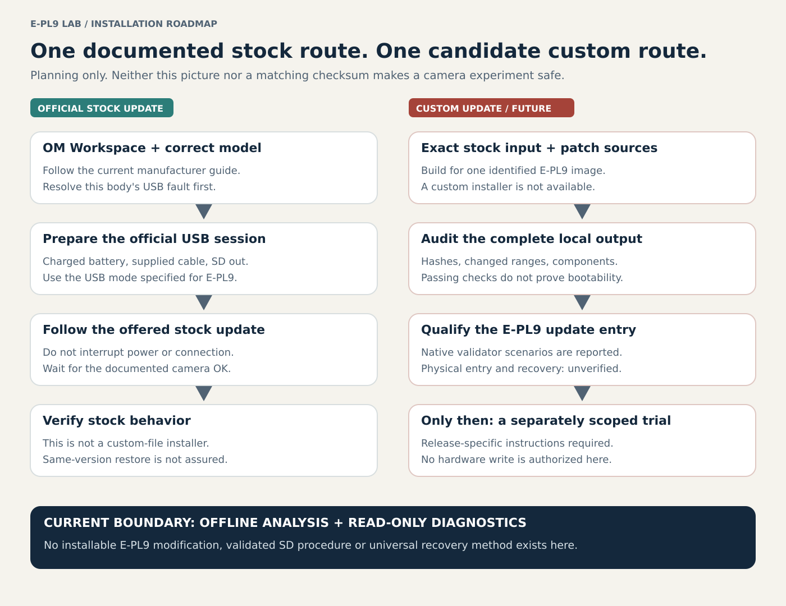

# Future firmware installation and recovery plan

**Status: planning only, not an E-PL9 flashing instruction or an installable release.** This project has not installed a modified image, validated the E-PL9 SD-update entry/completion behavior, or established a reliable stock-restore procedure. Current work remains offline analysis and read-only diagnostics. This document explains the intended route and what must be resolved before it becomes an executable guide.

Read the [risks](risks-and-limitations.md). A camera can become unusable, photographs can be lost, and paid repair may be required. A valid checksum, a working updater on another model, or a stock update file does not guarantee recovery.



The diagram is an original planning illustration. It does not show a tested E-PL9 installation.

## Research update, 2026-11-04

The recovery chat reports E-PL9-specific SD-client/service and package-validation execution, beyond the related-model references below. Its report and tests are not yet present in the public baseline reviewed here; these are **reported offline findings, not reproduced installation evidence**. See [source status](project-status.md#other-reported-work-separate-from-the-first-package).

Fifteen intercepted-write scenarios reportedly accept build-1101 main without a version bump, reject bad checksums including a later corrupt component before a write request, and request full-component restoration. They also expose two host-side safeguards to require: reject duplicate components (the tested native service selects the last main), and retain lower-layer write failures rather than trusting an outer success wrapper. Small in-memory packages and intercepted requests do not validate full-size programming, power-loss behavior or the actual storage hardware.

The SD client/service reportedly reside inside main. The **early physical entry, which code must survive damaged main, lamp/error/completion behavior and actual restore capability remain unresolved**. An ordinary install/restore on an intact test body would cover only that tested state, not every brick. Restoration must cover all changed components: main, OSD/icons and picture resources as applicable. A main-only restore is insufficient for a multi-component modification.

## Current package work, 2026-11-07

Native film hooks, a candidate early-load slot and partial native-menu icon validation are now published. The integration chat is assembling install and stock-return containers for the frozen Gold/Portra v3 direction, using main plus OSD/icons and retaining existing large example photographs. It plans full-size checks through the native validator with write requests intercepted. This is active work, not a passing package report or a camera-ready release.

Use [first-integration readiness](first-integration-readiness.md) to distinguish completed offline integration from the remaining package/runtime/update-entry/recovery gates. The host-probe MMIO boundary is not a physical camera failure; the menu route does not execute the processing hooks. No full BOOT dump, independent rescue path or harmless diagnostic-session entry is established.

## 1. Two routes with different evidence

| Route | Intended use | Evidence and present limit |
| --- | --- | --- |
| OM Workspace over USB | Manufacturer-provided stock updates | Officially documented. The project's earlier USB problems must be resolved before relying on it on this body; MTP enumeration alone does not establish update readiness. |
| Camera SD updater | Candidate for locally built modifications and subsequent updates | Related models have physical install reports. New E-PL9 service/validation execution is reported but awaits public source/reproduction; physical trigger, signals and recovery coverage remain unverified. |
| Hardware/service repair | Possible last resort when software update paths cannot start | No project-validated E-PL9 board recovery, programmer procedure or full-device backup exists. Do not count it as an available fallback. |

The official updater is not documented as a loader for this project's custom files. Do not substitute a modified image in its download/cache or send experimental USB write commands.

### Official stock updates

Use the manufacturer's [E-PL9 support page](https://learnandsupport.getolympus.com/ca-en/support/e-pl9), [OM Workspace instructions](https://support.jp.omsystem.com/en/support/imsg/digicamera/qa/contents/ow/ow_a2.html) and [current update guidance](https://explore.omsystem.com/us/en/firmware-update-instructions), checked on 2026-11-02. Their current model-specific instructions take precedence over this overview.

For a stock update, the documented outline is: use current OM Workspace, a charged battery and the supplied USB cable; remove the SD card; select the USB mode prescribed for the model; open **Camera → Update** and review the offered version. Follow its prompts and retain power/cable connection until the camera explicitly displays **OK**. E-PL9 falls under the older-model Storage route in the cited instructions, not the newer-model MTP examples. The manufacturer warns against interruption and does not offer normal downgrade as a supported operation. An already-current body may have no update offered; this does not provide a same-version restore method.

The official OI.Share firmware-update compatibility list on the linked page does not include E-PL9. Wi-Fi image transfer and an offline browser client are separate from firmware installation. Do not promise phone/browser flashing.

### Candidate SD route for our future packages

An SD updater reads an update file from the card and writes persistent internal firmware. It is not simply running a recipe from the card; removing the card would not undo a firmware change.

The candidate path carried forward from this project's recovery discussion is:

```text
SD card root
└── DCOLYMP/
    └── E1339999.BIN    [candidate E-PL9 name; not validated here]
```

**Do not use this tree as a ready-to-run procedure.** The name remains a research candidate in this guide, not an independently verified E-PL9 file-matcher contract. Renaming a file does not make another model's firmware compatible. The original stock filename and hashes must remain recorded separately.

The pinned [E-P7 installation report](https://github.com/cakelesscoder/caduceus-ep7/blob/7d42c1f258737b7196c6b17cec5d643b5080ece6/docs/INSTALL.md) describes a model-specific DCOLYMP file, entry using **OK while powering on**, and lamp-based completion. Those are E-P7 observations. The button sequence, lamp meaning, elapsed time and rejection behavior must not be presented as tested E-PL9 instructions. The [PEN-F recovery analysis](https://github.com/fishcu/oly_fw_analysis/blob/539fcf1fa9eda5fdef8ede4deeab94a4691d94c3/docs/boot/pen-f/RECOVERY.md) also separates a mapped updater from proof of its physical startup entry and recovery coverage.

Before documenting E-PL9 startup steps, publish/review the reported validator and file-matcher evidence, then establish physical entry, success/error signals and dependency on surviving startup code. Same-build acceptance by a native service is not physical same-version reinstall or stock restoration. Test those separately in a later scoped phase. There is still no project-specific duration, safe forced-stop timeout, or confirmed recovery key combination to recommend.

## 2. What a future release must contain

We intend to distribute original patch/build material and instructions, with users obtaining authorized stock input separately. Manufacturer firmware and extracted photographs remain outside the public repository. Published module and offline-overlay builders now exist; the active install/stock-return container work must still publish its exact outputs and qualified validation. No camera-tested release is established.

| Required item | Purpose |
| --- | --- |
| Exact-input manifest | Model, displayed-version prerequisite, internal build, source provenance, byte sizes and SHA-256 of stock container and components |
| Pinned source revision and local build instructions | Reproduce changes against that input; reject unknown images instead of disabling hash checks |
| Patch/change manifest | Original-byte assertions, intended new ranges, unique component identities, scope and explicit exclusions; reject duplicates before any future trial |
| Output manifest | Built container/component sizes and hashes, package revision and test results; the output hash must differ when bytes change |
| Release-specific install guide | E-PL9 procedure actually established for that package, including observed indications and limits |
| Separately identified stock-restore material | Exact stock identities for every modified component, plus a validated procedure with stated failure-state coverage; no universal-unbricking promise |
| Release notes and rollback limits | What changed, known issues, camera states tested and whether firmware/settings compatibility limits restoration |

A locally built modified file must never be checked against the stock hash as though they should match. The stock input is fixed; each modified output needs its own audited hash. Reusing an old display version is not a reliable way to identify a custom build.

## 3. Reduce avoidable risk before any future camera trial

These are preparation requirements for a later, separately authorized trial; they do not make a trial safe or authorize writing now.

1. **Identify the exact body and files.** Record model, displayed body/lens versions, prior modifications and the build manifest. A downloaded stock update has not been proven identical to every byte currently installed on the owner's camera.
2. **Preserve independent copies.** Copy irreplaceable media off the card, keep immutable stock and candidate build copies on the computer, and record important settings manually. Use software settings backup only if that model/function explicitly supports it. A settings export or stock update is not a full flash/calibration backup.
3. **Audit the complete output offline.** Verify component/container checks, exact changed ranges, untouched-component identity and decode/re-encode consistency. Check code bounds, resource allocation, callbacks, buffer lifetime, cache invalidation and non-target modes. An isolated table test cannot substitute for the full affected processing paths.
4. **Avoid combining independent experiments.** Start from a single reviewed package scope. Wi-Fi throughput changes, OpenGate, gyro logging and a larger recipe catalog must not silently enter the first two-slot ART build.
5. **Resolve install and restore prerequisites.** Confirm E-PL9-specific entry, rejection/success indications and same-version/stock acceptance. Document which failure states leave the updater reachable. Do not damage a working body to demonstrate a hypothetical brick-recovery path.
6. **Prepare the actual trial environment.** Use a reliable spare card with no irreplaceable files, known-good charged battery, stable physical setup and uninterrupted power. If USB is the route, resolve the existing connection fault and follow the vendor's requirements. Card preparation/formatting and hardware writes require their own later session scope.
7. **Verify what was copied.** For an eventual card-based release, use only the intended release's updater payload, show file extensions, and hash the copied file on the card against that release's output manifest. Keep the stock-restore file separately labeled so identical updater filenames cannot cause confusion. Do not leave multiple candidate update files for the camera to choose between.

Read-only stock identity check, from a local checkout with the exact input present:

```powershell
Get-FileHash -Algorithm SHA256 -LiteralPath .\firmware\OLY_E_133_1101_0000_0000.BIN
```

Expected stock size: `104552480` bytes. Expected SHA-256: `aefab05396c43ecba0551b94a5d31f7e52350c18d6f4bf1d02d75761108e6028`. This command reads a computer file only; it neither prepares a card nor updates a camera.

## 4. What the eventual installation guide will explain

After the missing evidence is established, the release-specific guide should walk through **verify package → prepare card/connection → enter the confirmed updater → observe writing → confirm the documented completion indication → restart as specified → verify behavior**. Initial installation and later custom updates may use the same SD mechanism if E-PL9 acceptance is demonstrated; this is not yet guaranteed.

During a validated update, do not remove power, battery, card or required USB cable while writing. An unexpected signal or black display is not proof of success, rejection or a frozen camera. Do not invent a power-cycle timeout or import another model's lamp interpretation. The release guide must describe the model-specific observation and escalation path before a trial begins.

Small recipe or icon edits may still require rewriting an entire component: related models do this, and E-PL9 write granularity needs its own confirmation. Do not plan to flash every development iteration. Most iterations should remain offline. No E-PL9 hot-reload recipe mechanism or automatic rollback is established.

## 5. Acceptance and restoration after a future trial

The planned acceptance session will record startup, both target slots, live view, saved JPEGs, RAW availability, settings persistence and unrelated controls. Use repeatable exposure/white balance and the same scene for stock/modified comparisons. A new name/icon proves only UI content; it does not prove that Watercolor processing was removed or that a recipe is calibrated. Check caches when switching repeatedly between Gold and Portra, not only after a cold start.

After verified successful completion, remove or archive the updater payload using the release's documented procedure, keeping photos and any separate configuration data intact. Card removal alone does not restore stock firmware. Preserve logs and hashes for the installed build.

| Observed state | Possible investigation / recovery route | Remaining limit |
| --- | --- | --- |
| Normal boot and stable official USB recognition | Manufacturer support/update route, where it offers an applicable stock update | Same-version reinstall and rollback may be unavailable |
| Normal boot fails, independently confirmed SD entry still works | An exactly identified stock package via that validated SD path | Only the tested failure states are covered; a candidate path alone is insufficient |
| Neither confirmed update entry works | Qualified service assessment; hardware research only as a separate project | No ready-to-use E-PL9 programmer or universal recovery procedure here |

The reported first package writes main and OSD only and retains the picture component. Its stock-return material must restore both changed components; do not silently reuse an older main-only restore.

An update image may omit boot/storage/calibration regions. Preserving it does not preserve every device-specific byte. Never call this plan "brick-proof" or imply that a failed main application always leaves an independent rescue loader intact.

## Evidence and next work

The official route above comes from the linked manufacturer sources. The custom SD plan incorporates pinned related-model reports and newer chat-reported E-PL9 validator scenarios. The public source for the latter still needs to be integrated and reviewed; no E-PL9 hardware installation was performed to update this guide. Physical button/indication behavior, early-entry resilience and actual restoration remain unverified. Preserve the distinction between a mapped native validator, an intercepted write request and successful physical programming.

See the [illustrated change plan](planned-changes.md), [current processing evidence](epl9-integrated-prototype.md), [handoff](porting-guide.md) and [changelog](../CHANGELOG.md). Future findings should update the relevant evidence status before this planning document is promoted to installation instructions.
