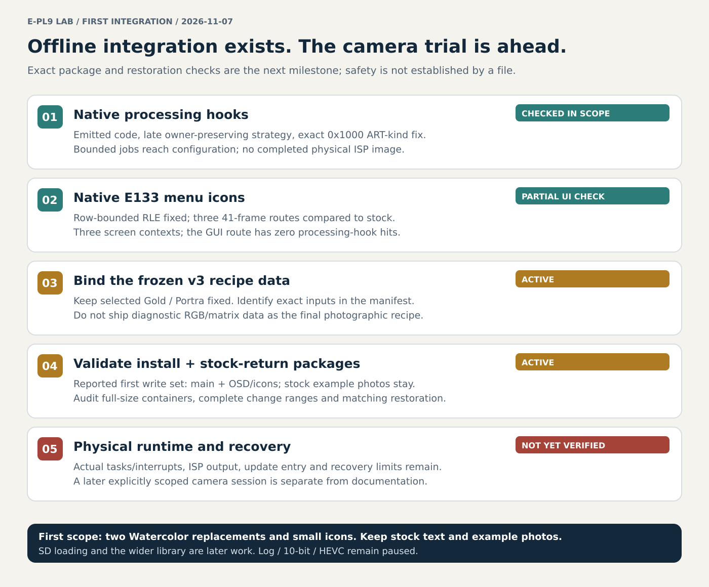

# First integration readiness: 2026-11-08

**Source follow-up:** the [explicit native v3 input path](epl9-native-v3-input-binding.md)
now feeds complete pinned inputs into emitted HSL/tone/RGB/WB/matrix/six-axis
logic without silently inheriting v0/v2 numerical data. The actual frozen
v3 files, exact firmware inputs and full-size container results are still
unavailable here. This source-level integration and its synthetic tests do
not close the package or physical-camera gates below.

**The first native offline integration already exists. The first camera-test package is being prepared; a camera-ready or demonstrably safe release is not established.** Emitted processing hooks and native-menu icon checks are materially beyond the earlier Python-only experiments, but neither executes the physical sensor/TruePic/storage combination.

This review uses published main `1f4dc523fc8db1a61863da66a09413627d5eb8e8` plus the active integration, recipe-review, SD-loading, video and recovery chats checked on 2026-11-07. Chat-only artifacts are labeled below; their source and private results are not supplied by this checkout. No camera operation, packaging experiment or exact-image audit was performed to write this page.

## What "first integration" means

| Milestone | Current state | What that does and does not establish |
| --- | --- | --- |
| Native processing integration on the host | **Exists; bounded native execution is published** | Emitted route/color/gamma/WB hooks, owner/callback controls and a placement/load candidate work in the tested state. Not merely Python pointer insertion; still no hardware image output. |
| Native UI integration in an emulator | **Partially validated** | Corrected G200/P400 icons render in three E133 screen contexts, with controlled stock comparisons. The ART dial/example screen has a modeling gap; two bitmap pairs are unobserved. |
| Exact current photographic recipe binding | **Current v3 review is reported; final package binding is active** | The owner prefers the current Gold/Portra v3 direction and has asked not to alter it. The public numerical source in this checkout still provides v0/v1/v2 and diagnostic integration cases, not a verified complete v3 release manifest. |
| Install and stock-restore containers | **Being assembled/checked by the integration chat** | The intended first package changes main and OSD/icons only. A validated full-size package and matching stock-restore result are not yet published here. |
| First experimental camera session | **Not reached** | Physical update entry/completion, running processing under real tasks/interrupts and restoration coverage remain unresolved. No on-camera Gold/Portra image has been produced. |

This places the work **past an offline proof of concept and into package/preflight preparation**, not at a finished release. A percentage, date or numerical brick probability would imply evidence we do not have. The practical next milestone is an exactly identified, audited test candidate and matching restore material, with the remaining risks made reviewable.

## Scope to keep fixed for the first candidate

- Replace only Watercolor I and II with the selected **Gold 200 / Portra 400 v3 direction**, plus their small icons. Keep these two recipes fixed during packaging; tuning the wider library is separate.
- **Keep the existing large ART example photographs unchanged.** This later owner instruction supersedes the early plan to replace them. The latest tested text labels also remain Watercolor I/II; do not claim completed renaming or silently add it to the package.
- The integration chat currently intends to write **main and OSD resources only**. Its return-to-stock package must restore those same changed components. Picture resources and unrelated components are outside that planned write set.
- Do not add the SD recipe loader, wider recipe library, Wi-Fi optimizations, video/gyro changes or paused Log/10-bit/HEVC work to this first package.

## Published processing progress

The [late integration](epl9-late-film-integration.md) replaces the earlier early-object strategy. It keeps the original ART identity and owner object, uses temporary tone-control state, installs retained table/curve pointers, and restores the request after native configuration. Source assembly and emitter/probe code are present in the repository. Default and diagnostic recipe data must not be confused with the final photographic v3 input.

The [native producer/binding report](epl9-native-owner-binding.md) found an important defect that synthetic inputs had missed: a stock ART producer emits request kind **`0x1000`**, while the old gates recognized only three other kinds. Routing changed but the recipe settings were skipped. All three gates now accept this exact additional kind while retaining exact target-mode checks. Four connected positive cases reach native configuration; four pre-cancelled cases return `0x9e01` and release the modeled job/cache allocations through stock cleanup.

The [WB/placement](epl9-wb-math-placement.md) and [owner/load validation](epl9-native-owner-load-validation.md) reports qualify more arithmetic, selected native callbacks, stack observations and early-load chunks around the candidate slot at `0x604a1300`. Those are scoped checks. They do not establish all runtime writers, cache execution/coherence, concurrent jobs, interrupt stacks, secondary creator bindings or every resource callback. The four positive native-producer cases still stop at **`0x6073eafa → 0x9880014c`**, without output pixels or a completion signal.

The native source has therefore advanced substantially. The remaining hardware boundary must stay visible; it cannot be replaced by success stubs. A complete host ISP emulator is not asserted as a prerequisite for every possible camera experiment, but any untested hardware behavior must be an explicit residual risk in that later experiment's plan.

## Published icon/UI progress

The [OM-Emu report](epl9-omemu-ui-validation.md) found that the old icon encoder allowed RLE runs to cross rows. The extraction decoder reconstructed the pixels, but the emulated OSD engine rejected the stream with `BMP_TOKEN`. The corrected encoder terminates runs at each scanline and preserves the artwork, descriptors and existing allocations.

Three 41-frame stock/icons-only/combined routes have matching button actions and GUI states. Icons-only and combined frames match; ten frames differ from stock only in icon areas. The tested resources cover both inline symbols and two bitmap pairs in the Picture Mode list, Shooting Menu 1 value and shooting indicator. The full diagnostic history matches stock, including its known pre-existing `BMP_LUT` signature.

**All five processing-hook counters remain zero on that GUI route.** Native menu screenshots therefore validate selected icon integration, not image processing. The ART/example screen's `FMT_UNMODELLED` gap and two unobserved pairs remain outside coverage. Screenshots and firmware-derived assets stay private; the diagrams in this repository are explanatory illustrations.

## Work in progress outside this public baseline

| Workstream | Latest reported activity | Integration consequence |
| --- | --- | --- |
| Two-slot v3 package | Build install and stock-return containers, preserve recipes, include only main and OSD, and run full-size files through native validation with intercepted write requests. | Active preflight work, not a passing package result. Publish source revision, input/output hashes, component manifest and validation outcome when available. |
| Broader library | A separate 29-recipe library is under review against eight shared scenes. The owner prefers Gold/Portra's stronger coherent rendering and excludes them from these edits. | This is neither 29 camera menu slots nor permission to retune the first two recipes. Preserve accepted library variants and keep review conclusions separate from native camera output. |
| Later SD loading | The owner prefers most recipes built in with some future SD-backed/open slots; the exact split and mapping remain undecided. | Prepare research only. No E-PL9 loader, hot reload or E-P7 file compatibility is established; validate the two Watercolor replacements first. |
| 4:3 video/gyro | Aspect-ratio handlers reportedly retain 1440 in some cases, but fixed 1920×1080 branches and source-mode classification still need tracing for normal FHD60. | No demonstrated full-field 1920×1440/60 or synchronized gyro recording; exclude from the first film package. |
| Recovery/USB | A reported camera-side MTP filter blocks the memory-read operation; the diagnostic-session path has unknown nonvolatile side effects. | No verified full-flash/BOOT dump tool or independent rescue path. Do not enter an opaque service mode merely to improve readiness. |

## Before calling a package a first-test candidate

1. **Bind the intended values.** Identify the exact accepted v3 HSL/tone/WB/curve/matrix inputs and verify that the actual emitted module consumes them. Diagnostic RGB/matrix/six-axis values must not accidentally ship as final recipes. Preserve source hashes and the owner's freeze.
2. **Audit exact complete containers.** Verify source model/build/hashes, unique component identities, every hook/module/icon change, untouched components, size/address/header/checksum consistency and deterministic reconstruction. Run the full-size candidate and stock-restore through the qualified native validator with writing intercepted. Small synthetic-package checks are not a substitute.
3. **Match the restoration scope.** Restore all and only the modified components with exact stock bytes. Test duplicate components, late-component corruption and lower write-error propagation in host checks. A successful upper status must not hide an unexamined lower failure.
4. **Review runtime assumptions.** Record the remaining caller/stack, concurrency, owner/table lifetime, code-slot writer/cache, input/crop/CFA and completion assumptions. Resolve issues that invalidate the proposed execution path; label the rest as limits rather than claiming all contexts are covered.
5. **Document the physical trial and its recovery limits.** Establish what is known about E-PL9 update entry, completion indications and which damaged states leave that path accessible. A stock file and ordinary USB recognition do not prove recovery after startup corruption. No immutable rescue loader or universal unbricking procedure is established.
6. **Keep the future write session separate.** This documentation request does not authorize flashing. A later explicitly scoped trial needs the identified candidate, backups/settings notes, appropriate power/card/connection preparation and a concrete acceptance plan.

The acceptance plan should distinguish boot and navigation, both selected slots, preview versus captured JPEG, RAW preservation, repeated recipe switching, power-cycle persistence, unrelated-mode regressions, processing time and error/cancellation behavior. A UI icon proves none of those pixel results. Physical ISP behavior is what a carefully scoped hardware trial would eventually have to assess; it is not already established by the current emulator checks.

See [current status](project-status.md), [future installation/recovery](firmware-installation-plan.md), [scope](research-scope.md) and [changelog](../CHANGELOG.md). **Log, 10-bit and HEVC remain paused.**
