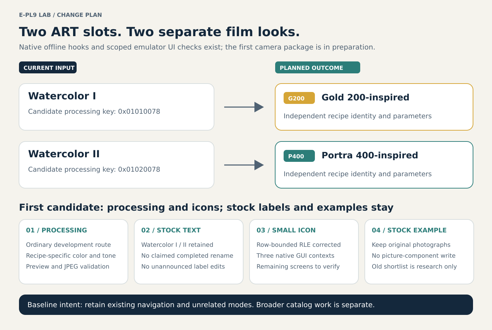
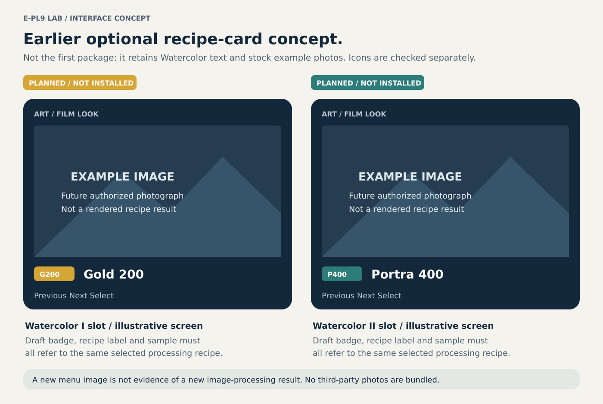

# Illustrated change plan

**These are plans and research results, not screenshots of installed firmware or demonstrated Gold/Portra output.** The first integration baseline is the two accepted Watercolor slots. A broader recipe catalog is being discussed separately; neither slot expansion nor a redesigned menu follows from this baseline.

Original schematic; dimensions and arrangement are illustrative. The camera's existing menu structure and unrelated controls are to be preserved for this baseline.

## The four changes must agree

| Layer | Present / observed | Intended result | Still required |
| --- | --- | --- | --- |
| Image processing | The inspected image contains candidate Watercolor I/II keys and their shared processing branch | Separate Gold 200-inspired and Portra 400-inspired rendering, with the Watercolor-specific spatial effect removed where appropriate | Complete connected processing, native object/cache contracts, real pixels, preview/capture coverage and calibration |
| Recipe name | English Watercolor I/II labels are associated with distinct UI values | Names that identify the correct recipe in the applicable screens | Targeted string/resource encoding, language/screen coverage and an audited rebuild |
| Small icon / inline badge | Separate I/II bitmap and symbol resources were decoded | Distinct G200 / P400 icons in existing native sizes | Runtime palette/screen validation and integration; draft assets fit their checked allocations but are not installed |
| Large menu example | Picture resources and visual candidates have been extracted; runtime selection is unresolved | A correctly mapped, authorized example image for each slot | Resolve actual resource bindings, choose licensed/owner-approved content, encode within allocation and check on screen |

A label change alone is not a film look. A new sample photograph does not change processing. A valid icon encoding does not establish a bootable firmware package.

## What the selection screen could show

**Concept only, not a camera capture.** The empty image areas intentionally do not simulate the uncalibrated recipe's output. They represent future authorized example images; the drawing does not specify exact final layout, typography, palette or menu order.

Existing original draft artwork is available for inspection:

| Gold slot | Portra slot |
| --- | --- |
|  |  |

The [icon report](epl9-watercolor-icons.md#standalone-replacement-artwork-2026-11-02) records all ten encoded candidates fitting their tested bitmap/symbol allocations and round-tripping through an independent decoder. The artwork remains a draft. Shared Roman numeral symbols and generic resources must not be overwritten globally.

For menu photos, the [source shortlist](epl9-art-example-pictures.md#digital-recipe-photo-shortlist-2026-11-02) links digital-recipe examples made on Fujifilm cameras. They are references, not E-PL9 results or permission to redistribute them. No third-party photograph is copied into these illustrations. The example-picture binding is still open: visually similar resources 360/361 and UI table values 399/400 must not be treated as interchangeable verified targets.

## Processing changes are deeper than color-table replacement

The intended flow is **retain the selected I/II recipe identity → choose a valid ordinary processing route → supply that recipe's color/tone parameters → preserve normal completion and ownership → render the correct preview and captured image**. It must preserve detail, unaffected modes and stable switching between recipes.

The current [connected-job investigation](epl9-integrated-prototype.md#connected-constructor-frame-start-and-consumer-2026-11-02) reaches request-consumer configuration with explicit host resources. It has not produced pixels or a JPEG. The earlier COLOR table checks are separate experiments and must not be described as a completed end-to-end recipe.

The native cache comparison reads a parameter object's field at +20 but does not directly compare its table pointer at +16. Consequently, merely exchanging Gold/Portra table pointers could retain stale settings. The eventual integration needs the actual invalidation and lifetime contract, not an invented flag update. Live view, captured JPEGs, warm recipe switching and power-cycle persistence must be checked independently.

## Parallel investigations and how results become part of this plan

Snapshot checked on 2026-11-02. The following work areas are active or discussed in other research chats; uncommitted chat findings are leads, not automatically published or reproduced evidence. This document creates no new camera feature commitment.

| Work area | Current basis | Integration condition |
| --- | --- | --- |
| ART processing and resource integration | Published exact-image reports and connected offline probe; no full pixel cycle | Audited implementation, target/control comparisons and completed processing evidence |
| Deeper color and tone control | Separate inquiry into available native controls and a restrained common rendering base | Verified numerical behavior and image calibration; a Classic Chrome-like reference is not a demonstrated Fujifilm implementation |
| Larger film-recipe catalog | Separate recipe/ordering discussion | Reconcile accepted scope, actual slot/menu capacity, artwork rights and per-recipe evidence before packaging |
| Wi-Fi original-file throughput | Separate offline investigation; candidate file-read/transport overhead, no proven acceleration | Publish reviewed report and reproducible measurements; do not fold speculative transport changes into the ART package |
| Full-field 1920×1440 at 60 fps | Requested target in the video research chat | Establish sensor readout, field of view, bandwidth and encoder/timing support; changing output dimensions alone is insufficient |
| Gyro logging during video | Separate diagnostic/firmware leads | Establish raw sample availability, rate, timestamp/video synchronization, buffering and recording impact; a diagnostic CSV routine is not a working recording logger |

Detailed results should move into model/build-specific repository reports with input identity, pinned source, commands, tests, unresolved points and an entry in [CHANGELOG.md](../CHANGELOG.md). Local Windows paths or a chat statement alone are insufficient public evidence. The [contribution rules](../CONTRIBUTING.md) and [handoff guide](porting-guide.md) define the format.

For installation planning, start with [future installation and recovery](firmware-installation-plan.md). Its candidate SD path remains blocked on E-PL9-specific validation; these illustrations are not instructions to flash the camera now.
