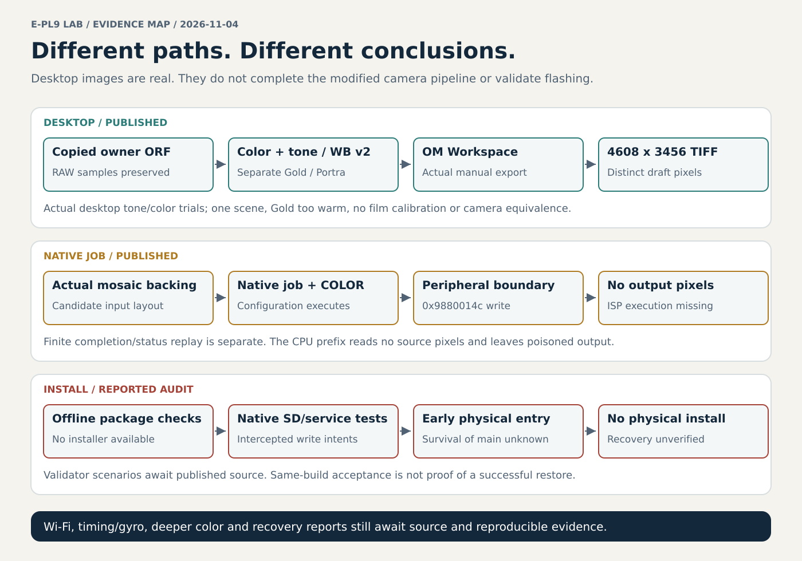

# Project status: 2026-11-04

This is the current cross-project handoff. Read it before treating an older report's "next step" as the present blocker. The November 2 reports retain their original observations; this page distinguishes subsequent native-code progress, actual desktop images, and newer results reported by other chats.

**No modified firmware has been installed by this project, and no complete modified-camera pixel cycle or validated E-PL9 recovery procedure is established. Real full-resolution desktop Gold/Portra color/tone/WB draft images do exist.** These statements describe different execution paths.

## Evidence reviewed

- Published research baseline: main commit `a399202a0d7ded05eedc4120b5e4676fcf059a70`, including native completion/hardware/RAW audits, the Workspace CMIO bridge and versioned v0/v1/v2 recipes. The tone/WB follow-up was published during this refresh and is now integrated, rather than remaining a pending chat claim.
- Later source commits, if merged into this branch, remain the authority for their detailed reports. The commit above identifies the evidence reviewed for this summary, not a claim that development has stopped.
- Recent processing, color, Wi-Fi, video, installation/recovery and recipe-design chats were reviewed on 2026-11-04. Findings without corresponding public files are recorded separately below as **reported, not reproduced here**. Private chat identifiers and original media are not published.
- The current cloud checkout runs **99 tests successfully** after acquiring the pinned external OSD decoder with its recorded CRLF bytes and importing the ten published tone/WB tests. The earlier pre-tonal cloud run passed 89; the latest reported 167-test Windows total includes other workspace tests and is not this public checkout's count. No exact-image audit, Windows DLL invocation, owner-image export or physical-camera test was rerun during this documentation refresh.

All firmware-specific published work uses the identified Olympus E-PL9 1.1/build 1101 input, not a dump of the installed body. See [exact input identity](epl9-1.1-initial-findings.md#exact-stock-input). Matching hashes identify files, not compatibility or safe installation.

## Published results that can be inspected from this checkout

| Area | Latest established result | Remaining limit / next question |
| --- | --- | --- |
| Native ART processing | The connected job constructs native objects, attaches table state, builds requests and reaches hardware configuration. Completion/error/teardown contracts have separate executed checks. | Separate status replay is not real ISP completion; no complete modified-firmware image is produced. |
| Source/destination descriptors | The host destination-offset error was corrected and preserved as a negative control. Native terminology distinguishes Bayer, 4AspectsData and YCC. | Stride or an oversized allocation does not establish actual pixel packing, crop or CFA. |
| Real ORF input | Actual expanded mosaic samples reach eight native configuration cases. The prefix makes zero source-pixel instruction reads and leaves destinations poisoned. | All cases stop at the unmapped peripheral write `0x6073eafa → 0x9880014c`; actual TruePic processing is missing. |
| Desktop parameter transport | Owner-made 4608×3456 Workspace TIFF exports respond to changed CMIO coefficients while RAW samples remain identical. A strong desaturation control confirms the route. | This invokes the desktop renderer, not the modified native job or a validated equivalent camera ISP. |
| Gold / Portra v0 | Both original coefficient proposals are versioned; actual full-size TIFF exports have distinct pixels. Gold is subtle in the supplied scene; Portra reduces the channel-range proxy more. | Color-only drafts, not calibrated film matches. No native hook, installed ART replacement or qualified preview/capture behavior. |
| Tone / white balance v1/v2 | Published copied-ORF trials preserve RAW data. V1's isolated gamma edit gives zero pixel difference; v2's joint stock contrast/H/S/M route changes actual TIFFs and produces valid native configuration curves. | Not independent validation of each tone field, software/camera equality or a calibrated film look; Gold is too warm in the test scene. |
| Icons and menu photos | Ten original G200/P400 icon candidates fit and round-trip in checked allocations. External digital-recipe photo references are documented. | Actual screen/palette behavior and large-photo runtime bindings remain open. Linked photos are not licensed public bundle assets. |

Read the detailed [completion](epl9-completion-contracts.md), [hardware/descriptor](epl9-hardware-completion.md), [real-RAW](epl9-real-raw-boundary.md), [Workspace](epl9-workspace-cmio-bridge.md), [v0 film-draft](epl9-film-draft-trials.md) and [v1/v2 tone/WB](epl9-tonal-neutral-trials.md) reports. The distinction between CPU configuration and pixel execution must remain visible in every summary.

The v0 report measures mean absolute RGB changes of **0.5224/255** for Gold and **1.4230/255** for Portra against the neutral desktop control in one scene. Large percentages of changed pixels do not establish a visually strong look or film fidelity. Original images and detailed private manifests remain ignored; this summary does not redistribute them.

The v2 follow-up measures **8.6685/255** and **14.0331/255** against the same neutral control. Portra's v2 input differs from its stock-gamma v1 control in only six bytes within four contrast/H/S/M values, qualifying the joint adjustment under the recorded manual-export conditions. Gold is quite orange and Portra's shadows are substantially lighter in this indoor scene. No tested image reaches channel value 255, so highlight roll-off remains unqualified. V2 is the current public draft; v0 and the negative v1 gamma trial remain historical controls.

## Newer reported work awaiting publication or independent reproduction

These entries preserve useful handoffs without inventing missing files, commands or verification. Paths below name expected reports in the originating Windows workspace; they are not links to files delivered by this checkout. Test counts are those reported by the originating work, not checks run here.

| Area / expected report | Reported result | What must accompany integration |
| --- | --- | --- |
| `epl9-deep-color-controls.md` | Separate RGB curves, a 256-point luminance curve, channel matrix and another color block were identified in selected code. Forty component checks and 29 tool tests were reported. | Publish exact addresses, selection/attachment contracts and tests. The found custom RGB path uses a shared curve for three channels; independent channel selection and whole-image behavior need qualification. No Classic Chrome implementation is established. |
| `epl9-wifi-offline-prototype.md` | Native `rd` trials reportedly preserve full ORF/MOV bytes while reducing intermediate copying from about 14.69 MB to 165 bytes and 8.11 MB to 456 bytes. A separate ISC reuse model retains waits and reduces per-block resource creation. Twenty-one tests, 144 read cases and six full comparisons were reported. | Publish the isolated scripts and source provenance. Resolve full-sector success semantics and stale duplicate ISC responses. Saved operations are not measured camera throughput; no acceleration is proven. |
| `epl9-video-timing-sync.md` | The latest chat reports the phase calculation behind `marker+4` and a path connecting `D+44/D+76` to an image owner/stabilizer request. The model uses 144 ticks/µs and gives 43.78 ms for the unmodified FULL template. | Publish current audit revision and distinguish the timing model from measured hardware. TG clock source and IRQ bit-0 physical phase remain unknown; the exposure/video-buffer/MOV-PTS chain is incomplete. No full-field 1920×1440/60 result. |
| `epl9-gyro-logging.md` | Earlier diagnostic Yaw/Pitch/Roll and CSV paths are leads for recording-time logging. | Establish raw rate, timestamps tied to video, buffer ownership, dropped-sample behavior and simultaneous recording. A diagnostic CSV routine is not a working Gyroflow logger. |
| `epl9-installation-recovery.md` | Fifteen native-code scenarios with intercepted write requests reportedly identify E-PL9 SD/service validation, accept build 1101 main, reject corrupt later checksums before writes, and request whole-component restoration. Duplicate main selects the last entry; some lower write errors are hidden by an outer wrapper. | Publish the audit/tests and full-size package coverage. The mapped SD client/service live in main; early power-on entry and survival of damaged main remain unresolved. No physical installation, immutable rescue loader or universal restore proof. |

The recovery work reports a full-main write request of **26214400 bytes**. Keep that reported request length distinct from the **26214336-byte decoded payload**; exact write-span/header accounting belongs in the source audit. Restore planning must cover every changed component, including OSD and picture resources, not only main.

An earlier video update mentioned a calculated 36 MHz CLK_CAMOUT branch. Its relationship to the TG counter was not established. Neither that value nor the later 144-ticks/µs model is a standalone sensor-fps measurement. The model's FULL duration is neither proof of 60 fps nor proof that a different full-field mode is physically impossible.

## Scope and decisions carried forward

The first implementation baseline remains Watercolor I → Gold 200-inspired and Watercolor II → Portra 400-inspired, with correct names/icons/examples and unrelated behavior preserved. The owner also requested a broader 31-profile visual catalog and recipe-specific icons. That is a design backlog: 31 working slots, final ART replacement mapping and menu ordering are not demonstrated firmware capabilities. The current video target is full-field **1920×1440 at 60 fps**, with synchronized gyro logging if feasible.

There is no new permission to flash, reset, erase files or issue vendor writes. Documentation changes and successful desktop experiments do not expand that boundary. See the [installation plan](firmware-installation-plan.md) for the updated recovery evidence and remaining preconditions.

## Next concrete work

1. Tune the now-published v2 drafts against neutral targets, additional illuminants and highlight-rich scenes. Preserve the negative v1 gamma result, original v0 color controls and distinction between joint tone response and isolated field behavior.
2. Resolve the true camera input/crop/CFA, ISP/data/coherence and completion contracts. Retain poison checks, pixel-read observations, cache invalidation, ownership and non-target-mode regressions.
3. Publish the Wi-Fi, deep-color, timing/gyro and recovery audits independently, with exact input identity and reproducible commands; then integrate their qualified conclusions into this index.
4. Resolve the early E-PL9 SD entry and define restoration for every modified component. Reject duplicate components on the host, verify complete packages and keep lower-level write errors visible.
5. Update the [changelog](../CHANGELOG.md), [directory index](README.md), [illustrated plan](planned-changes.md) and affected dated reports when new evidence changes a conclusion. Preserve history and the distinction between proposed, reported, locally reproduced and on-camera results.
